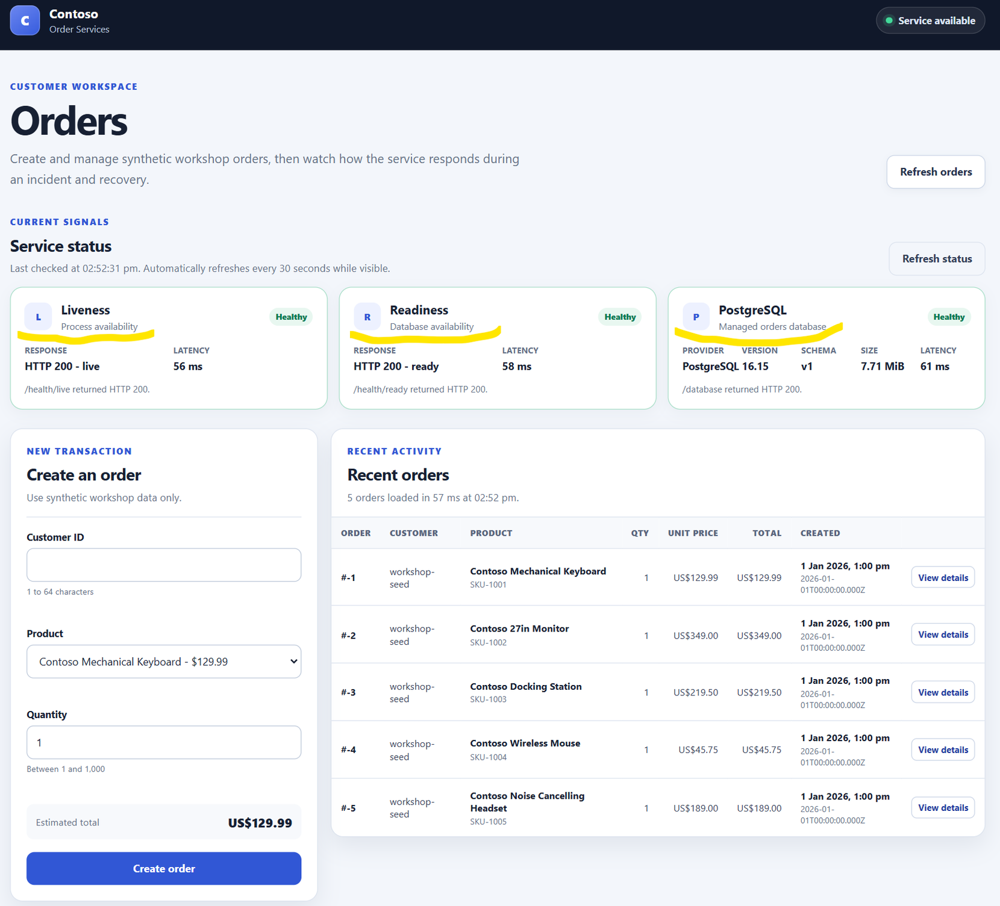
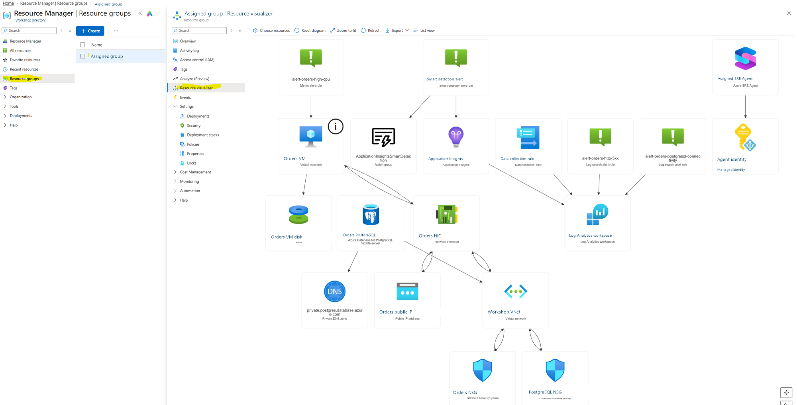

<p align="center">
  
</p>

<h1 align="center">Azure SRE Agent Workshop</h1>

<p align="center">
  <strong>Break a real Azure workload on purpose, then let Azure SRE Agent investigate.</strong>
</p>

<p align="center">
  <a href="https://charliekw411.github.io/sre-agent-workshop/"><strong>Start the workshop</strong></a>
  ·
  <a href="#quick-start">Quick start</a>
  ·
  <a href="#learning-path">Learning path</a>
  ·
  <a href="facilitator-process/README.md">Facilitator runbook</a>
  ·
  <a href="CONTRIBUTING.md">Contributing</a>
</p>

<p align="center">
  <a href="https://github.com/charliekw411/sre-agent-workshop/actions/workflows/deploy-docs.yml"></a>
  <a href="LICENSE"></a>
</p>


Deploy a small but realistic Azure workload, establish an evidence baseline,
trigger two controlled incidents, and use Azure SRE Agent to investigate the
resulting alerts. Then schedule a proactive agent health check and build a Live
Report. The six-module path takes about three and a half hours and does not
require an instructor.

## See it in action

| Deploy and validate | Investigate an incident |
| --- | --- |
|  |  |
| A healthy baseline: the app, its private database, and its telemetry. | The agent correlates VM metrics, request telemetry, and alert context. |

| Review the fix | Know what was deployed |
| --- | --- |
|  |  |
| Cause, customer impact, and mitigation, with evidence kept apart from inference. | One disposable resource group: VM, private PostgreSQL, monitoring, alerts, and the agent. |

## What it costs

Most of the cost is the SRE Agent itself, which is billed in Azure Agent Units
(AAUs). In this tenant, one AAU billed at about US$0.11.

* **Always-on flow:** 4 AAUs per agent-hour (about US$0.44), from the moment
  the agent is created until it is deleted, whether or not anyone uses it.
* **Active flow:** AAUs for the LLM tokens the agent uses on chats, incident
  investigations, and scheduled tasks. A typical alert investigation is roughly
  12 to 35 AAUs, depending on the model.
* **Everything else** is normal Azure pricing for the VM, PostgreSQL, Defender
  for Cloud, monitoring, and networking.

Final bill for a real 20-participant run: deployed Monday 19 October 2026
(about 14:50 to 15:50 NZDT) across three subscriptions, workshop on Tuesday 20
October, and deleted Wednesday 21 October (about 13:10 NZDT), roughly 46 hours.

| Cost | Billed (USD) | Share |
| --- | --- | --- |
| SRE Agent (6,500 AAUs) | $715.00 | 85% |
| Virtual machines | $60.90 | 7% |
| Defender for Cloud | $21.50 | 3% |
| PostgreSQL | $20.19 | 2% |
| Azure Monitor and Log Analytics | $11.97 | 1% |
| Network, storage, DNS, bandwidth | $8.93 | 1% |
| **Total (rg-01 to rg-20)** | **$838.48** | **about $41.92 per participant** |

By billing day (UTC): Monday $524.19, Tuesday $313.98, Wednesday $0.31. About
$400 of the SRE Agent charge was the always-on rate (20 agents for about 45
hours) and about $315 was active flow. The VMs and databases were stopped
overnight, so they billed about 28 of the 46 hours; the agent bills
continuously, so delete environments promptly. See
[Cost Management](docs/sre/30-appendix/03-cost-management.md) and
[Azure SRE Agent pricing](https://learn.microsoft.com/azure/sre-agent/pricing-billing).

Figures are actual cost from Azure Cost Management for `rg-01` to `rg-20` only.
They exclude other resource groups in the same subscriptions, such as extra
participants and failed or test deployments. Treat them as one run's result,
not a quote.

Want to run this workshop for your team, customers, or community? If you're a
Microsoft customer or partner, get in touch at
[ckakewhite@microsoft.com](mailto:ckakewhite@microsoft.com).

## Quick start

Prerequisites are listed [below](#prerequisites). From a cloned repository:

```bash
az login
az account set --subscription "<your-subscription-id>"
azd auth login
azd env new "<your-alias>-sre-vm-aue"
azd env set AZURE_LOCATION australiaeast
azd up
```

Then validate the deployment:

```bash
source .workshop/workshop.env
python scripts/workshop.py smoke
```

Open the workshop site and continue with
[Module 01](https://charliekw411.github.io/sre-agent-workshop/sre/01-deploy-and-validate/).
When you finish, remove everything with `azd down --purge --force`; see
[Cost and cleanup](#cost-and-cleanup).

## Pick the workflow you need

| Goal | Command | Full guide |
| --- | --- | --- |
| Deploy the workshop for yourself | `azd up` | [Self-deployment](docs/sre/30-appendix/06-self-deployment.md) |
| Deploy isolated environments for a cohort | `python scripts/cohort.py deploy --participants 5 ...` | [Facilitator runbook](facilitator-process/README.md) |
| Validate the workload and telemetry | `python scripts/workshop.py smoke` / `inspect` / `telemetry` | [Use and validate the workload](#use-and-validate-the-workload) |
| Trigger the high CPU incident | `python scripts/workshop.py fault cpu 600 2` | [Module 03](docs/sre/03-incident-high-cpu/index.md) |
| Trigger the PostgreSQL connectivity incident | `python scripts/workshop.py fault postgresql` | [Module 04](docs/sre/04-incident-postgresql/index.md) |
| Install the dedicated incident workflow | `python scripts/workshop.py incident-workflow install` | [Incident workflow](docs/sre/30-appendix/09-incident-workflow.md) |
| Upload the knowledge base | `python scripts/workshop.py knowledge install` | [Knowledge base](docs/sre/30-appendix/10-knowledge-base.md) |
| Schedule the proactive health check | `python scripts/workshop.py health-check install` | [Module 05](docs/sre/05-scheduled-health-check/index.md) |
| Reset incidents | `python scripts/workshop.py fault reset` | [Controlled incidents](#controlled-incidents) |
| Tear everything down | `azd down --purge --force` | [Module 06](docs/sre/06-cleanup/index.md) |
| Run the docs site or app locally | `python -m mkdocs serve` | [Local and Codespaces](docs/sre/30-appendix/04-local-and-codespaces.md) |
| Troubleshoot | | [Troubleshooting](docs/sre/30-appendix/02-troubleshooting.md) |

## What you learn

* Validate an application, its private database dependency, and its telemetry
  before declaring deployment success.
* Follow Azure Monitor alerts into an Azure SRE Agent response-plan
  investigation.
* Correlate customer behavior, VM metrics, PostgreSQL dependencies, availability
  results, and Azure control-plane changes.
* Distinguish observed evidence from inference in an AI-generated investigation.
* Schedule a read-only agent health check and build a refreshable Live Report
  from the same telemetry.

## Learning path

| Module | Title | Duration |
| --- | --- | --- |
| 01 | Deploy and Validate the Workshop | 45 min |
| 02 | Operate the SRE Agent Response Plan | 25 min |
| 03 | Respond to High CPU | 40 min |
| 04 | Respond to PostgreSQL Connectivity Loss | 40 min |
| 05 | Schedule a Health Check and Build a Live Report | 40 min |
| 06 | Preserve Evidence and Clean Up | 20 min |

## What gets deployed

The workshop uses one Azure region and one disposable resource group:

* One Ubuntu 24.04 VM, `Standard_D2as_v5` by default, running the public .NET 8
  Orders API and browser GUI as a non-root `systemd` service.
* A private Azure Database for PostgreSQL Flexible Server 16 using
  `Standard_B1ms`, 32 GiB storage with auto-grow, no high availability, and
  seven-day locally redundant backups.
* An Orders subnet at `10.240.0.0/27` and a PostgreSQL delegated subnet at
  `10.240.0.32/27`.
* The private DNS zone `private.postgres.database.azure.com`; PostgreSQL public
  access is disabled.
* A static public IP and Azure DNS name for HTTP port 8080. SSH and public
  fault-injection endpoints are not exposed.
* Log Analytics, workspace-based Application Insights, Azure Monitor Agent, a
  Data Collection Rule, and CPU, PostgreSQL dependency, and HTTP 5xx alerts.
* A Low-access Azure SRE Agent with an enabled Sev1/Sev2 response plan in
  Review mode (the optional PostgreSQL plan runs Autonomous; see below). Its
  UAMI has Reader and Contributor on the workshop resource
  group, Log Analytics Reader on the workspace, and the required
  subscription-level Monitoring Contributor role for the Azure Monitor alert
  lifecycle.

The VM's system-assigned managed identity obtains Microsoft Entra tokens for
PostgreSQL and connects with TLS `VerifyFull`. The same identity is also the
PostgreSQL Entra administrator. That administrator/runtime combination is an
intentional privilege shortcut for a disposable workshop. A production design
should use separate provisioning and runtime identities and grant the runtime
identity only the database privileges the application needs.

### Why a private managed database

Keeping PostgreSQL on the application VM would be cheaper, but it would couple
database and VM lifecycle, put both components in one failure domain, and remove
the network dependency that Module 04 investigates. A public managed database
would retain managed operations but expose a public endpoint and rely on public
firewall configuration. The private Flexible Server gives repeatable
provisioning, independent database lifecycle, private name resolution, and a
realistic dependency boundary without database passwords.

This remains a cost-conscious workshop rather than a production reference
architecture. The API has one VM, the database has no HA, and both are in one
region. The separate managed service improves isolation, backup behavior, and
database lifecycle, but it does not remove those deliberate failure-domain
tradeoffs.

## Repository layout

```text
.
├── agent/              Health-check and incident-workflow definitions
├── azure.yaml          Azure Developer CLI project definition
├── docs/               Workshop content published to GitHub Pages
├── infra/              Bicep templates and the azd deployment entry point
├── scripts/            Validation, load, and controlled-fault helpers
├── src/                Orders API, browser GUI, and application tests
├── web/                Authenticated documentation-site controls
├── mkdocs.yml          Site configuration
└── Makefile            Documentation build targets
```

## Prerequisites

* Subscription `Owner`, or `Contributor` plus `User Access Administrator`, to
  create the resource group and deployment-managed role assignments.
* Azure Developer CLI 1.18 or later.
* Azure CLI 2.60 or later. No Azure CLI extension is required.
* Python 3.10 or later with the packages in `requirements.txt`.
* Bash with `curl` and `jq`, or PowerShell 7, plus OpenSSH `ssh-keygen`.
* Node.js 20 or later when building the documentation site's authenticated
  controls.
* Permission to query the workspace and execute VM Run Command for live
  validation.

Azure deployment does not require a local .NET SDK or Docker. Application tests
do require the .NET 8 SDK and a real PostgreSQL 16 instance, normally started by
Testcontainers through a running Docker daemon. See
[Running Locally or in Codespaces](docs/sre/30-appendix/04-local-and-codespaces.md).

## Deploy the workshop

The [quick start](#quick-start) commands, from a cloned repository:

```bash
az login
az account set --subscription "<your-subscription-id>"
azd auth login
azd env new "<your-alias>-sre-vm-aue"
azd env set AZURE_LOCATION australiaeast
azd up
```

Use a new environment. Preflight checks that Azure CLI and azd use the same
principal and tenant, registers required providers, verifies the selected VM
capacity, and verifies that PostgreSQL 16 with `Standard_B1ms` is advertised in
the region. It does not change region, request quota, create policy exemptions,
or substitute another SKU.

The resource group is tagged
`workshop-architecture=single-vm-postgresql-v1`. A resource group with another
architecture tag is rejected rather than migrated, partially reused, or
deleted.

`azd up` then:

1. Provisions the VM, two subnets, private DNS, PostgreSQL, monitoring, alerts,
   and SRE Agent.
2. Assigns the SRE Agent UAMI Contributor on the workshop resource group and
   Monitoring Contributor on the subscription.
3. Makes the VM identity the PostgreSQL Entra administrator.
4. Installs the .NET 8 SDK and PostgreSQL client on the VM.
5. Validates private DNS, TCP 5432, managed-identity token acquisition, and TLS
   configuration.
6. Applies the PostgreSQL schema and deterministic seed data.
7. Enables `orders-api.service` and verifies local and public health.
8. Configures and reads back the SRE Agent response plan.
9. Verifies `/orders`, `/database`, and the absence of public `/fault/*` routes.

Repeated `azd up` reconciles the normal
`PostgreSqlFaultInjection` rule to `Allow`, reapplies the idempotent schema
bootstrap, and keeps existing orders. The final output includes resource names,
IDs, and the public API URL. The generated `.workshop/workshop.env` and
`.workshop/workshop.ps1` files use an explicit non-secret allowlist. They do not
contain a PostgreSQL password or access token.

Monitoring Contributor is intentionally subscription-scoped because the SRE
Agent alert scanner requires it. The agent's managed-resource configuration and
Contributor access remain limited to its workshop resource group. Review mode
still requires approval before Azure changes, except for the dedicated
PostgreSQL plan, which runs Autonomous and may only restore the NSG rule. `azd down` and the cohort cleanup
remove the subscription role assignment before deleting the resource group and
its scoped assignments.

### Deploy a participant cohort

For the short organizer sequence from identity preparation through cleanup, use
the [facilitator end-to-end runbook](facilitator-process/README.md).

Use the cohort wrapper when the Entra users already exist and each participant
needs Contributor access to one isolated resource group plus SRE Agent Standard
User and Administrator access to that group's agent:

```bash
python scripts/cohort.py deploy \
  --participants 5 \
  --subscriptions "<subscription-1>" "<subscription-2>" "<subscription-3>" \
  --user-prefix "sre-test-workshop-participant" \
  --user-domain "<tenant>.onmicrosoft.com"
```

`--participants 5` creates only `participant-01` through `participant-05` and
`rg-01` through `rg-05`. The subscriptions are assigned round-robin, so five
participants across three subscriptions use a 2/2/1 split. Increasing the same
command to `--participants 20` extends the saved cohort to `rg-20` with a 7/7/6
split.

Before deployment, the command validates all participant UPNs, subscriptions,
required providers, regional service availability, PostgreSQL availability,
aggregate VM quota, and existing resource-group tags. It then deploys
with up to two environments per subscription in parallel, runs the public,
private database, telemetry, and fault-status checks, and assigns the matching
user the built-in Contributor role on only their resource group and SRE Agent
Standard User and Administrator on only that group's agent. With three subscriptions, at most six
environments run at once. Use
`--parallel-per-subscription 1` if a subscription needs more conservative
throttling.

Progress and resumable private state are written under `.workshop/cohort/`.
The final terminal table and `.workshop/cohort/roster.json` use subscription
labels instead of subscription IDs. Rerunning the same command skips ready
environments and resumes failed or incomplete ones from the first unfinished
deployment, validation, or RBAC stage.

Cleanup verifies the workshop tags before deleting anything:

```bash
python scripts/cohort.py cleanup --participant participant-03 --yes
python scripts/cohort.py cleanup --all --yes
```

The deployment identity must be able to create role assignments, such as Owner
or Contributor plus User Access Administrator. These environments are intended
for same-day use; delete them promptly because the VM, PostgreSQL server,
monitoring, public IP, and always-on SRE Agent continue to incur charges.

## Use and validate the workload

Load the generated values and run the supported checks:

```bash
source .workshop/workshop.env
python scripts/workshop.py smoke
python scripts/workshop.py inspect
python scripts/workshop.py verify-restart
python scripts/workshop.py telemetry
```

Open `SERVICE_ORDERS_API_ENDPOINT_URL` to list, create, inspect, and update
synthetic orders. The status cards call:

* `/health/live` for process liveness
* `/health/ready` for schema-backed readiness
* `/database` for `provider`, `status`, `serverVersion`, `schemaVersion`, and
  `databaseBytes`

The GUI refreshes those three status routes every 30 seconds while its tab is
visible.

`inspect` verifies the non-root service, private PostgreSQL DNS resolution, TLS
`verify-full`, PostgreSQL 16, schema migration, deterministic seed rows, and
local health. `verify-restart` binds its persistence witness to
`POSTGRESQL_SERVER_RESOURCE_ID`, restarts only the VM, and confirms that the
same order remains in the separately managed database.

`telemetry` waits up to ten minutes for VM heartbeat and CPU data, Orders API
requests, PostgreSQL dependencies, and availability results. PostgreSQL
operations appear in `AppDependencies` with
`DependencyType == "PostgreSQL"`.

## Controlled incidents

The normal outbound NSG child rule is:

| Property | Value |
| --- | --- |
| Name | `PostgreSqlFaultInjection` |
| Priority | `100` |
| Direction | `Outbound` |
| Protocol | `Tcp` |
| Source | `10.240.0.0/27` |
| Destination | `10.240.0.32/27` |
| Destination port | `5432` |
| Normal access | `Allow` |


Module 04 changes only this rule from `Allow` to `Deny`. It does not modify
orders, stop the database server, expose PostgreSQL publicly, or interrupt
unrelated outbound traffic. Because NSGs preserve established flows, the
control then restarts only `orders-api` to drain its Npgsql pool and retries
until liveness is HTTP 200 while readiness and `/orders` return the controlled
database-unavailable HTTP 503. Reset restores and reads back `Allow`, restarts
only the API, and requires liveness, readiness, and `/orders` to recover before
reporting success. A later `azd up` also reconciles `Allow`.

Terminal controls are:

```bash
python scripts/workshop.py fault cpu 600 2
python scripts/workshop.py fault postgresql
python scripts/workshop.py fault status
python scripts/workshop.py fault reset-cpu
python scripts/workshop.py fault reset-postgresql
python scripts/workshop.py fault reset  # Explicitly reset all scenarios
```

The CPU incident uses authenticated VM Run Command. The PostgreSQL incident uses
an authenticated ARM deployment of the fixed NSG child rule followed by VM Run
Command to recycle only `orders-api` and verify the application data plane. The
browser launcher uses `data-sre-incident="postgresql"` and performs an
authenticated rule GET, conditional PUT, read-back, API recycle, and bounded
health/order verification. An NSG read-back alone is never reported as a
successful inject or reset.

The PostgreSQL connectivity alert is
`alert-orders-postgresql-connectivity`; it fires on any failed PostgreSQL
dependency in five minutes. Existing CPU and HTTP 5xx alerts remain enabled.

Browser participants need read access to discover the environment and query
telemetry, VM Run Command permission for CPU and API-recycle actions, and read/write
permission on the specific `PostgreSqlFaultInjection` security rule for the
PostgreSQL action. The deployment does not create participant assignments.
Prefer a custom role at the narrowest supported scope rather than broad VM or
network contributor access. See
[Configure the Site Azure Connection](docs/sre/30-appendix/05-site-azure-connection.md).

## Dedicated PostgreSQL incident workflow

The participant class uses Igor's dedicated PostgreSQL incident workflow. A
facilitator installs it after `azd up`:

```bash
python scripts/workshop.py incident-workflow install
python scripts/workshop.py incident-workflow status
```

It adds `orders-incident-workflow`, `orders-alert-investigator`, and three
incident skills. The installer gives the original plan the scalar filter
`alert-orders-h` for CPU and HTTP 5xx alerts, while the dedicated plan uses
`postgresql`. Both remain enabled for Sev1/Sev2 without overlapping. The
dedicated plan runs in **Autonomous** mode, and its investigator may make one
Azure write: restoring `PostgreSqlFaultInjection` to `Allow`. The original plan
stays in Review mode.

The classroom installation leaves GitHub and Outlook destinations unbound, so
issue and email follow-ups remain draft-only. See
[Incident Workflow Setup and Routing](docs/sre/30-appendix/09-incident-workflow.md).

## Knowledge base documents

Two static Markdown files under `agent/knowledge/` hold fictitious Contoso
Retail demo data: SLIs, SLOs and baselines, and escalation and communications
templates. A facilitator uploads them to the agent's Knowledge settings:

```bash
python scripts/workshop.py knowledge install
python scripts/workshop.py knowledge status
python scripts/workshop.py knowledge remove
```

`remove` deletes only the files in `agent/knowledge/`. See
[Knowledge Base Setup](docs/sre/30-appendix/10-knowledge-base.md).

## Scheduled health check and Live Report

The participant class also uses the proactive scenario. A facilitator installs
it after `azd up`; self-deployments can run the same commands:

```bash
python scripts/workshop.py health-check install
python scripts/workshop.py health-check status
python scripts/workshop.py health-check remove
```

`install` writes a skill (`proactive-health-check`), a custom agent
(`health-report-investigator`), and a scheduled task
(`orders-daily-health-report`) to the SRE Agent, reads all three back, and
records `.workshop/<environment>/scheduled-health-check.json`. The definitions
live under `agent/`. The installer attaches only read-only tools to the custom
agent, pins its optional tool categories empty, and runs the task in Review mode,
and the agent's Azure role is Reader. In testing, scheduled runs did not apply
the custom agent's tool list, so Module 05 has you verify every tool call in the
run's thread. `remove` deletes only those three items.

The SRE Agent evaluates the schedule in UTC. The task runs Monday to Friday at
09:00 New Zealand Standard Time (NZST, UTC+12) using the cron expression
`0 21 * * 0-4`. During New Zealand daylight time (NZDT, UTC+13) it runs at 10:00
local time; use `0 20 * * 0-4` for 09:00 NZDT. Reports show New Zealand time
beside UTC. You can also run the task on demand from the portal.


You create the Live Report in the SRE Agent portal from a prompt in Module 05.
Live Reports is a preview feature and has no template or documented API.
Creating a report, and running its queries when you open or reload it, needs the
SRE Agent Standard User, SRE Agent Author, or SRE Agent Administrator role.
Approving the report's tool needs Administrator, which `azd up` gives to the
person who deployed the agent. Each task run and each report creation or update
consumes Azure Agent Units, so remove the task when you finish.

## Cost and cleanup

The VM, PostgreSQL Flexible Server, private DNS and network resources,
monitoring, public IP, alerts, and SRE Agent can all incur charges. Resetting an
incident restores connectivity but does not stop billing.

Scenario-specific resets do not change the other fault. Before collecting final
healthy evidence or deleting the environment, run the explicitly global
`python scripts/workshop.py fault reset`. If you installed the Module 05 health
check, also run `python scripts/workshop.py health-check remove`; the recurring
task uses agent units on every scheduled run. When finished:

```bash
azd down --purge --force
```

This removes the workshop resource group, including the VM, private network and
DNS resources, PostgreSQL server and backups, monitoring, alerts, and SRE Agent.
Deletion is permanent. Use only synthetic data.

## Run the documentation site locally

```bash
python3 -m venv .venv
source .venv/bin/activate
python -m pip install -r requirements.txt
npm ci
npm run build:web
python -m mkdocs serve
```

Open
[http://localhost:8000/sre-agent-workshop/](http://localhost:8000/sre-agent-workshop/).
Without tenant and SPA client configuration, the documentation remains readable
and Azure controls fail closed.

## Contributing

See [CONTRIBUTING.md](CONTRIBUTING.md). Do not include subscription IDs, tenant
IDs, resource IDs, tokens, connection strings, or real customer data in
documentation or screenshots.

## License

Licensed under the [MIT License](LICENSE).
