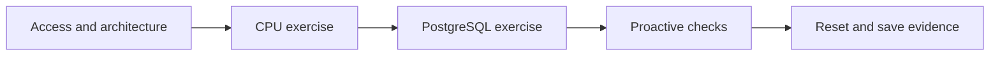

Use your assigned Azure environment to configure SRE response, trigger two
controlled faults, and watch the general and dedicated incident investigators.
Then run a scheduled health check and review a Live Report.

The infrastructure and your account are prepared before you arrive. The
browser exercises do not require a local terminal or an Azure deployment.

## Before you start

Get your account, sign-in and MFA instructions, assigned resource group,
workshop site, and SRE Agent link from your facilitator. After you connect, the
workshop site provides the Orders GUI link for your selected environment. Use
that account and environment throughout the workshop.

The Orders app runs on one VM and stores synthetic orders in private
PostgreSQL. Azure Monitor records its activity and sends alerts to the SRE
Agent. You check the agent's findings and reset the faults yourself.

## Learning path

| Module | What you do | Time |
| --- | --- | --- |
| [01 - Access and Understand the Workshop](sre/01-deploy-and-validate/index.md) | Sign in, review the architecture, check the healthy app, and meet the agent | 25 min |
| [02 - Configure SRE and Respond to High CPU](sre/03-incident-high-cpu/index.md) | Save response-plan settings, trigger CPU pressure, race the agent, and recover | 40 min |
| [03 - Respond to PostgreSQL Connectivity Loss](sre/04-incident-postgresql/index.md) | Block one database connection, evaluate the dedicated investigator, draft the follow-up, and restore it | 45 min |
| [04 - Deploy and Evaluate Proactive SRE Checks](sre/05-scheduled-health-check/index.md) | Run a scheduled task, check its findings, generate a Live Report, and compare incidents | 45 min |
| [05 - Reset and Preserve Evidence](sre/06-cleanup/index.md) | Draft a postmortem, turn off the scheduled task, and hand back the environment | 10 min |

Allow about three hours. Monitoring and alert waits vary.



For each incident, follow the same loop:

```text
configure SRE -> trigger the fault -> watch the agent -> check its claims -> reset
```

## Ground rules

* Use only your assigned environment and synthetic data.
* Read the scope of each fault before starting it.
* Check status before retrying an interrupted action.
* Check important agent claims against the app, charts, or logs.
* Reset one incident before starting the next.
* Do not delete organizer-managed resources.

If access or controls fail, ask your facilitator. Do not create replacement
resources or add permissions yourself.

[Start Module 01 :material-arrow-right:](sre/01-deploy-and-validate/index.md){ .md-button .md-button--primary }

## Reference guides

* [SRE configuration reference](sre/02-operate-response-plan/index.md)
* [Terminal setup and environment values](sre/30-appendix/01-variables.md)
* [Troubleshooting](sre/30-appendix/02-troubleshooting.md)
* [Incident workflow setup and routing](sre/30-appendix/09-incident-workflow.md)
* [Health-check setup](sre/30-appendix/08-proactive-extensions.md)
* [Self-deployment](sre/30-appendix/06-self-deployment.md), if you are doing the
  workshop independently
* [Organizer preparation and cleanup](sre/30-appendix/07-organizer-guide.md)

Resetting restores the app; it does not stop Azure charges. Organizers handle
resource deletion after the workshop.
