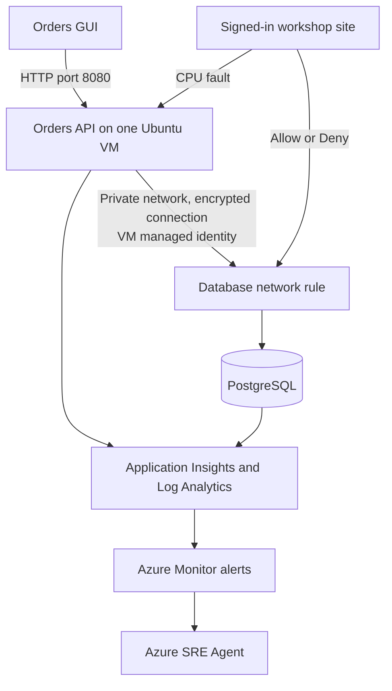
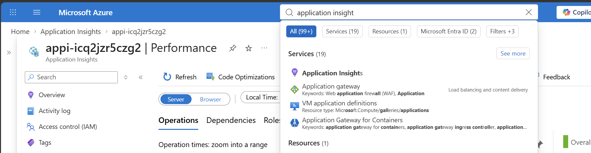
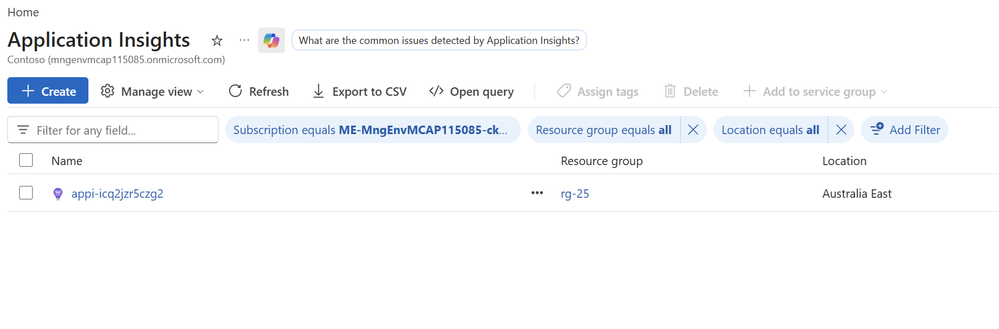
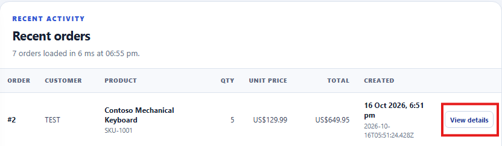
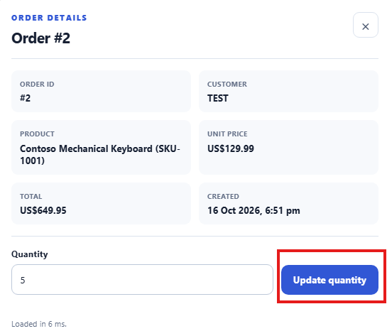
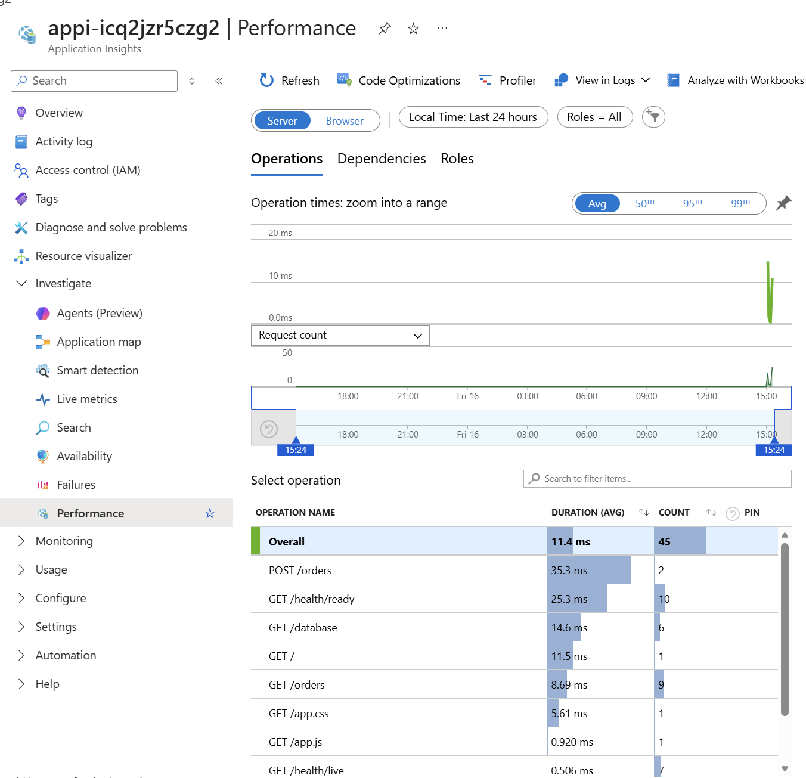

<ul class="sre-meta">
<li class="duration">Estimated time: 25 minutes</li>
<li>Module 01</li>
<li>Hands-on</li>
</ul>

## Learning objective

By the end, you can explain how an order reaches PostgreSQL, where the SRE Agent
gets its evidence, and what the agent can already tell you about your app.

## How we'll achieve it

Your environment is already deployed. You sign in, find your resources, check
the app and its monitoring, and ask the SRE Agent a first question. You do not
need to install tools or deploy Azure resources.

### Architecture



* **Orders GUI:** the customer view. It creates and reads synthetic orders.
* **VM:** runs the Orders API. Its Azure identity connects to PostgreSQL without
  a database password.
* **PostgreSQL:** a separate, private database. Restarting the VM does not delete
  its orders.
* **Monitoring:** records requests, database calls, VM health, and alerts.
* **SRE Agent:** uses those records to investigate. You check its findings and
  reset faults yourself.

The public app uses HTTP and has no sign-in. Use only synthetic data. There is
no public SSH or fault endpoint. The database is not publicly accessible.

This is a disposable lab, not a production design: one VM, a database without
high availability, and a VM identity that also administers the database.

## Tasks

### Task 1: Sign in

1. Collect what your facilitator supplies:
    * An internal Microsoft Entra account and sign-in instructions
    * A Temporary Access Pass (TAP), if used, with its expiration
    * MFA registration instructions
    * Your subscription display name and assigned resource group
    * The workshop site and SRE Agent link
2. Open the supplied workshop site and select **Not connected** in the header.
3. Sign in with the supplied account, not your personal Azure account, and
   follow the sign-in and MFA prompts. A TAP is a temporary sign-in code, not a
   password to reuse.
4. Keep the TAP private. If it has expired or been used, ask your facilitator
   for help. Do not put it in notes or screenshots.

### Task 2: Confirm your environment

1. When the header shows **Connected**, open it and compare **Account**,
   **Subscription**, and **Environment** with your handout.
2. The site selects the environment automatically when it finds only one. If a
   picker appears, select your assigned subscription and resource group, then
   **Use environment**.

    !!! warning "Use only your assigned environment"
        If no environment appears, or you can see another participant's environment,
        stop and tell your facilitator. Do not select a different group, change
        permissions, or deploy replacement resources.

3. Open **Connected** in the site header and select **Open Orders GUI**. Keep
   the new tab open for the workshop.
4. Open the [Azure portal](https://portal.azure.com/) with the same account.
5. Find your assigned resource group and locate its VM, PostgreSQL server,
   Application Insights, Log Analytics workspace, and SRE Agent. Use the actual
   names in that group; do not copy names from another attendee.

### Task 3: Check the app

In the **Orders GUI** tab, check customer impact while the workshop tab controls
the incidents.

1. Select **Refresh status** and check:

    | Card | Healthy result |
    | --- | --- |
    | Liveness | HTTP 200: the API process is running |
    | Readiness | HTTP 200: the API can reach its database schema |
    | PostgreSQL | Ready, PostgreSQL 16, schema version 1 |

2. Select **Refresh orders**.
3. Create an order with a made-up customer ID, open its details, and update its
   quantity.
4. Save the order ID and quantity in your notes.

    <!-- SCREENSHOT: Assigned Orders GUI with healthy status cards and a synthetic order; redact account and resource identifiers -->

5. If any check fails, use
   [participant troubleshooting](../30-appendix/02-troubleshooting.md#participant-access-and-starting-state)
   or ask your facilitator. Start the next exercise only from a healthy state.

### Task 4: Check the monitoring

1. Keep the Orders tab visible so its status checks continue. Refresh orders a
   few times.
2. In the [Azure portal](https://portal.azure.com/), type `application insight`
   in the top search bar and select **Application Insights** under **Services**.

    

3. Open the Application Insights resource in your resource group. Use the actual
   name in your list; do not open another attendee's.

    

4. In the left menu, under **Investigate**, select **Performance**. In the
   **Operations** table, look for recent `GET /orders`, `GET /health/ready`, and
   `GET /database` requests with counts above zero.

    The Orders GUI sends different requests for different actions:

    * Creating an order sends a `POST /orders` request.
    * Selecting **View details** on an order in the table sends a
      `GET /orders/{orderId}` request.
    * Selecting **Update quantity** on an existing order sends a
      `PUT /orders/{orderId}/quantity` request.

    Create and update an order in the Orders GUI, then look for the matching
    `POST` and `PUT` rows.

    

    

    

5. In the left menu, under **Monitoring**, select **Logs**, close the query
   picker if it appears, and run this query. It counts recent Orders API requests
   by name:

    ```kusto
    requests
    | where timestamp > ago(30m) and cloud_RoleName == "orders-api"
    | summarize Requests = count() by name
    ```

6. Check that you see rows with counts. Monitoring can take several minutes to
   catch up. Zero rows mean missing evidence, not a healthy service.

### Task 5: Meet the agent

1. Open your supplied **SRE Agent** link. On its **Connectors** page, confirm
   the monitoring connectors refer to your environment. If the workspace query
   or agent access fails, ask your facilitator rather than adding roles
   yourself.
2. Start a new chat and ask:

    ```text
    In plain language, what does the Orders app consist of, and how does an
    order reach PostgreSQL? Then list the monitoring data you can query. Do not
    make changes.
    ```

3. Compare the answer with the architecture diagram above. It should name the
   VM, PostgreSQL, Application Insights, and Log Analytics. Note anything that
   does not match.
4. Ask a second question:

    ```text
    Is the Orders app healthy right now? Show the evidence and the time window.
    ```

5. Check that its answer agrees with the status cards from Task 3. Note how long
   the agent took to gather and chart the evidence, compared with the portal
   steps you did by hand.

## Check before moving on

* [ ] Your supplied account is connected to your assigned environment.
* [ ] The Orders app is healthy and your synthetic order can be updated.
* [ ] Recent request records are available.
* [ ] The agent described the Orders app correctly and its health answer
      matched yours.

## Quick check

??? question "Why can liveness be healthy while readiness fails?"
    Liveness checks the API process. Readiness also checks PostgreSQL. A running
    process cannot serve orders if its database connection is broken.

??? question "Which tab do you use to start an incident?"
    Use the signed-in workshop site. The Orders GUI is the customer view and
    has no Azure incident controls.

??? question "What did the agent save you from doing by hand?"
    It queried several data sources, correlated them, and explained the result in
    one answer. You still checked it against the app, because the agent can be
    wrong.

## Next

[Configure SRE and respond to high CPU :material-arrow-right:](../03-incident-high-cpu/index.md){ .md-button .md-button--primary }

<div class="sre-nav" markdown>
[Workshop home](../../index.md)
[Module 02 - Configure SRE and Respond to High CPU :material-arrow-right:](../03-incident-high-cpu/index.md)
</div>
