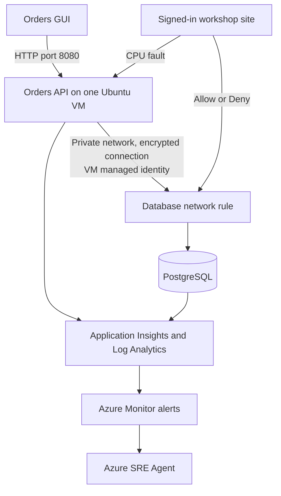

<ul class="sre-meta">
<li class="duration">Estimated time: 20 minutes</li>
<li>Module 01</li>
<li>Hands-on</li>
</ul>

## Overview

Your environment is already deployed. Sign in, find your assigned resources,
and check the app before starting the incident exercises. You do not need to
install tools or deploy Azure resources.

By the end, you can explain how an order reaches PostgreSQL and where the SRE
Agent gets its evidence.

## Architecture



* **Orders GUI:** the customer view. It creates and reads synthetic orders.
* **VM:** runs the Orders API. Its Azure identity connects to PostgreSQL without
  a database password.
* **PostgreSQL:** a separate, private database. Restarting the VM does not delete
  its orders.
* **Monitoring:** records requests, database calls, VM health, and alerts.
* **SRE Agent:** uses those records to investigate. You check its findings and
  reset faults yourself.

The public app uses HTTP and has no sign-in. Use only synthetic data. There is
no public SSH or fault endpoint. The database is not publicly accessible.

This is a disposable lab, not a production design: one VM, a database without
high availability, and a VM identity that also administers the database.

## Tasks

### Task 1: Sign in

Your facilitator supplies:

* An internal Microsoft Entra account and sign-in instructions
* A Temporary Access Pass (TAP), if used, with its expiration
* MFA registration instructions
* Your subscription display name and assigned resource group
* The workshop site and SRE Agent link

Open the supplied workshop site and select **Not connected** in the header.
Use the supplied account, not your personal Azure account. Follow the sign-in
and MFA prompts. A TAP is a temporary sign-in code, not a password to reuse.

Keep the TAP private. If it has expired or been used, ask your facilitator for
help. Do not put it in notes or screenshots.

### Task 2: Confirm your environment

When the header shows **Connected**, open it and compare **Account**,
**Subscription**, and **Environment** with your handout.

The site selects the environment automatically when it finds only one. If a
picker appears, select your assigned subscription and resource group, then
**Use environment**.

Open **Connected** in the site header and select **Open Orders GUI**. Keep the
new tab open for the workshop.

!!! warning "Use only your assigned environment"
    If no environment appears, or you can see another participant's environment,
    stop and tell your facilitator. Do not select a different group, change
    permissions, or deploy replacement resources.

Open the [Azure portal](https://portal.azure.com/) with the same account.
Find your assigned resource group and locate its VM, PostgreSQL server,
Application Insights, Log Analytics workspace, and SRE Agent. Use the actual
names in that group; do not copy names from another attendee.

### Task 3: Check the app

In the **Orders GUI** tab, check customer impact while the workshop tab controls
the incidents.

Select **Refresh status** and check:

| Card | Healthy result |
| --- | --- |
| Liveness | HTTP 200: the API process is running |
| Readiness | HTTP 200: the API can reach its database schema |
| PostgreSQL | Ready, PostgreSQL 16, schema version 1 |

Select **Refresh orders**. Create an order with a made-up customer ID, open
its details, and update its quantity. Save the order ID and quantity in your
notes.

<!-- SCREENSHOT: Assigned Orders GUI with healthy status cards and a synthetic order; redact account and resource identifiers -->

If any check fails, use [participant troubleshooting](../30-appendix/02-troubleshooting.md#participant-access-and-starting-state)
or ask your facilitator. Start the next exercise only from a healthy state.

### Task 4: Check the monitoring

Keep the Orders tab visible so its status checks continue. Refresh orders a
few times.

In your resource group, open **Application Insights > Performance**. Look for
recent `GET /orders`, `GET /health/ready`, and `GET /database` requests.

Open your **Log Analytics workspace > Logs** and run:

```kusto
union
  (Heartbeat
   | where TimeGenerated > ago(30m)
   | summarize Samples = count() | extend Signal = "VM heartbeat"),
  (Perf
   | where TimeGenerated > ago(30m) and CounterName == "% Processor Time"
   | summarize Samples = count() | extend Signal = "VM CPU"),
  (AppRequests
   | where TimeGenerated > ago(30m) and AppRoleName == "orders-api"
   | summarize Samples = count() | extend Signal = "API requests"),
  (AppDependencies
   | where TimeGenerated > ago(30m) and AppRoleName == "orders-api"
   | where DependencyType == "PostgreSQL"
   | summarize Samples = count() | extend Signal = "PostgreSQL calls"),
  (AppAvailabilityResults
   | where TimeGenerated > ago(30m) and AppRoleName == "orders-api"
   | where Name == "orders-api-postgresql"
   | summarize Samples = count() | extend Signal = "Database availability")
| project Signal, Samples
```

Each row should have samples. Monitoring can take several minutes to catch up.
Zero samples mean missing evidence, not a healthy service.

Open your supplied **SRE Agent** link. Confirm its monitoring connectors refer
to your environment. If the workspace query or agent access fails, ask your
facilitator rather than adding roles yourself.

## Check before moving on

* [ ] Your supplied account is connected to your assigned environment.
* [ ] The Orders app is healthy and your synthetic order can be updated.
* [ ] Recent request, database, and VM records are available.
* [ ] You can open your SRE Agent.

## Quick check

??? question "Why can liveness be healthy while readiness fails?"
    Liveness checks the API process. Readiness also checks PostgreSQL. A running
    process cannot serve orders if its database connection is broken.

??? question "Which tab do you use to start an incident?"
    Use the signed-in workshop site. The Orders GUI is the customer view and
    has no Azure incident controls.

## Next

[Configure SRE and respond to high CPU :material-arrow-right:](../03-incident-high-cpu/index.md){ .md-button .md-button--primary }

<div class="sre-nav" markdown>
[Workshop home](../../index.md)
[Module 02 - Configure SRE and Respond to High CPU :material-arrow-right:](../03-incident-high-cpu/index.md)
</div>
