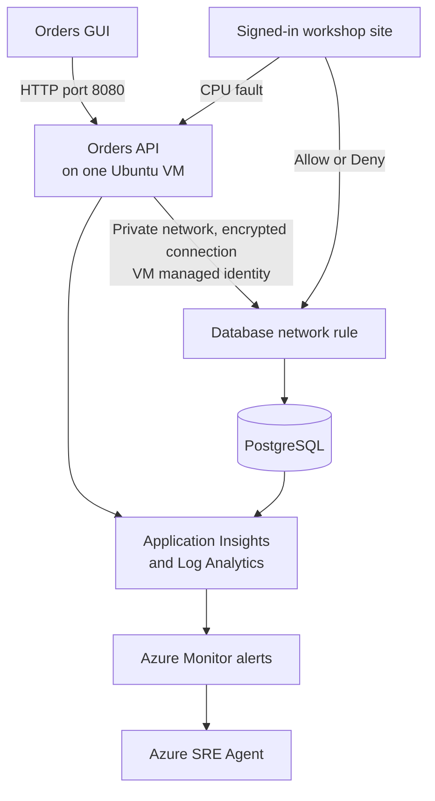
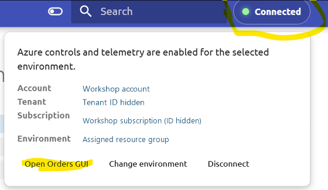
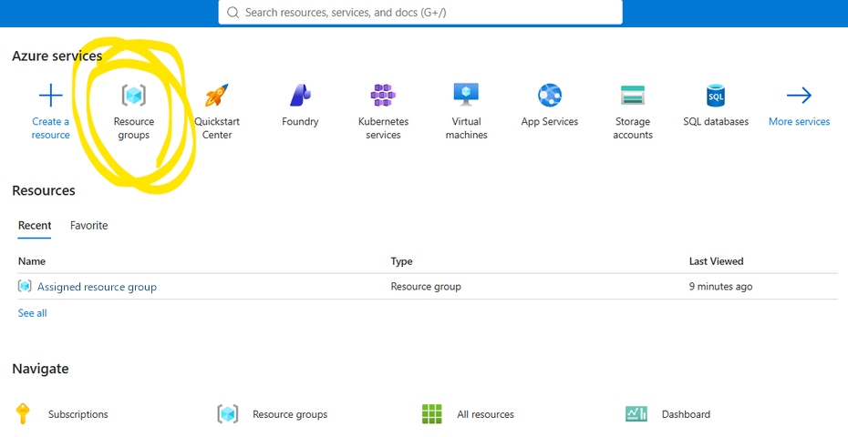
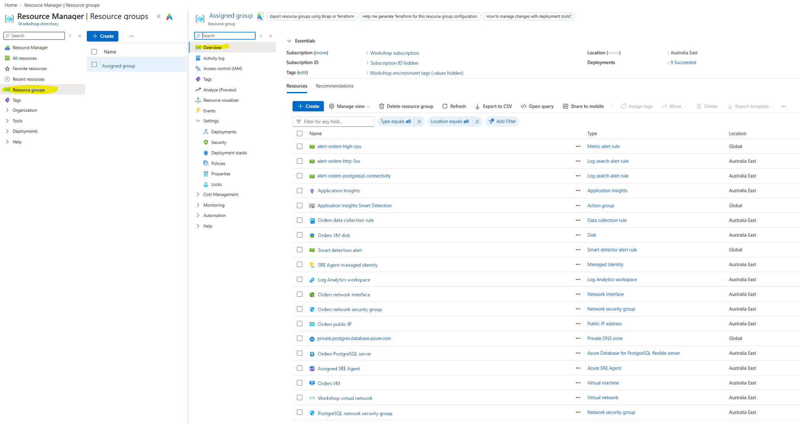
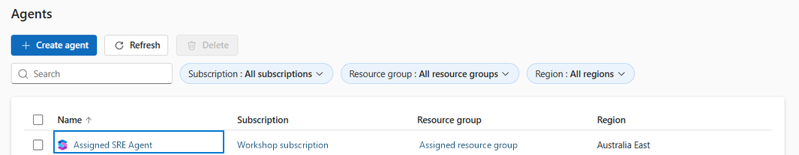
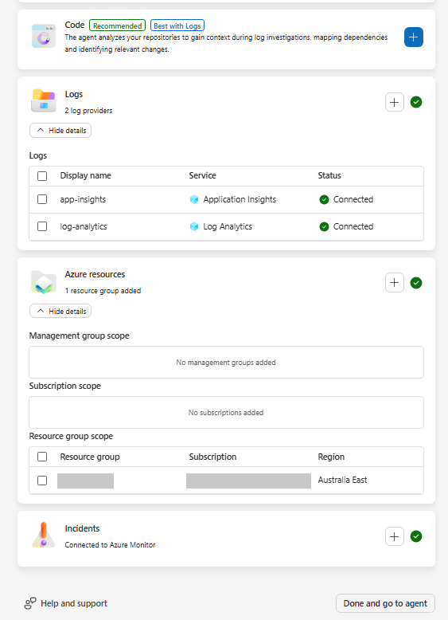
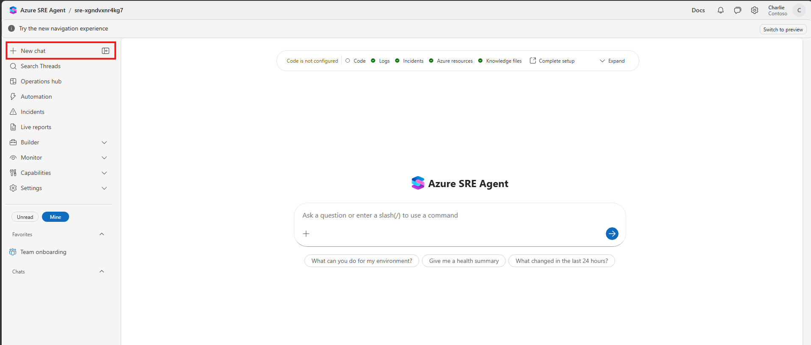

<ul class="sre-meta">
<li class="duration">Estimated time: 25 minutes</li>
<li>Module 01</li>
<li>Hands-on</li>
</ul>

## Learning objective

By the end, you can explain how an order reaches PostgreSQL, where the SRE Agent
gets its evidence, and what the agent can already tell you about your app.

## How we'll achieve it

Your environment is already deployed. You sign in, find your resources, check
the app and its monitoring, and ask the SRE Agent a first question. You do not
need to install tools or deploy Azure resources.

### Architecture

<div class="sre-architecture" markdown="1">

<label class="sre-architecture__toggle"><input class="sre-architecture__pause" type="checkbox"> Pause animation</label>

Follow the arrows and the four numbered explanations below. The matching nodes
and explanation highlight every six seconds. This illustrates the architecture,
not live service health. Pause the animation to inspect a stage. If your browser
requests reduced motion, the diagram stays still and all explanations remain
visible.



<ol class="sre-architecture__steps">
<li class="sre-flow-orders"><strong>Serve an order.</strong> The customer uses the Orders GUI. The API on the VM creates or reads synthetic orders in private PostgreSQL, using its managed identity and an encrypted connection instead of a database password.</li>
<li class="sre-flow-evidence"><strong>Collect the evidence.</strong> Application Insights and Log Analytics record requests, database calls, and VM health.</li>
<li class="sre-flow-investigation"><strong>Investigate an alert.</strong> Azure Monitor alerts reach the SRE Agent, which uses the monitoring evidence to investigate. You check its findings.</li>
<li class="sre-flow-controls"><strong>Control the lab faults.</strong> The signed-in workshop site starts bounded CPU pressure or changes the database network rule between Allow and Deny. Use that site to reset faults, not the customer-facing Orders GUI.</li>
</ol>

</div>

PostgreSQL is separate from the VM. Restarting the VM does not delete its orders.

The public app uses HTTP and has no sign-in. Use only synthetic data. There is
no public SSH or fault endpoint. The database is not publicly accessible.

This is a disposable lab, not a production design: one VM, a database without
high availability, and a VM identity that also administers the database.

## Tasks

### Task 1: Sign in

!!! tip "Start in a new private browser window"
    Open a new **InPrivate** window in Edge or **Incognito** window in Chrome.
    Keep the workshop site, Azure portal, Orders GUI, and SRE Agent tabs in that
    private window to avoid mixing your workshop and personal Azure accounts.
    Each site may still ask you to sign in.

Example labels such as **Assigned group** stand in for redacted account and
resource identifiers in the screenshots. Use the names from your own handout.
Select any screenshot to enlarge it.

1. Collect what your facilitator supplies:
    * An internal Microsoft Entra account and sign-in instructions
    * A Temporary Access Pass (TAP), if used, with its expiration
    * MFA registration instructions
    * Your subscription display name and assigned resource group
    * The workshop site and SRE Agent link
2. In your new private window, open the supplied workshop site and select
   **Not connected** in the header.
3. Sign in with the supplied account, not your personal Azure account, and
   follow the sign-in and MFA prompts. A TAP is a temporary sign-in code, not a
   password to reuse. If an environment picker appears, complete
   [Task 2, step 1](#task-2-confirm-your-environment). Once your environment is
   selected, the header shows **Connected**. Select it to see your account and
   environment.

    

    *The Connected panel confirms your sign-in and selected environment. It
    also contains Open Orders GUI, which you use in Task 2.*

4. Keep the TAP private. If it has expired or been used, ask your facilitator
   for help. Do not put it in notes or screenshots.

### Task 2: Confirm your environment

1. The site selects the environment automatically when it finds only one. If a
   picker appears, select your assigned subscription and resource group, then
   **Use environment**.

    !!! warning "Use only your assigned environment"
        If no environment appears, or you can see another participant's environment,
        stop and tell your facilitator. Do not select a different group, change
        permissions, or deploy replacement resources.

2. When the header shows **Connected**, open it and compare **Account**,
   **Subscription**, and **Environment** with your handout.
3. Open **Connected** in the site header and select **Open Orders GUI**. Keep
   the new tab open for the workshop.
4. Open the [Azure portal](https://portal.azure.com/){target="_blank" rel="noopener noreferrer"}
   in a new tab in the same private window. Sign in with your workshop account
   if prompted.
5. From the portal home page, select **Resource groups**. If the shortcut is not
   visible, type `resource groups` in the top search bar and select the service.

    

    *Start with Resource groups to find the environment assigned to you.*

6. Find and select your assigned resource group. On **Overview**, locate its
   VM, PostgreSQL server, Application Insights, Log Analytics workspace, and
   SRE Agent. Use the resource names shown in your group.

    

    *Match the group to your handout, then identify the resources you will use
    throughout the workshop.*

7. In the resource group's left menu, select **Resource visualizer**. Use
   **Zoom to fit** if needed, then find the VM, PostgreSQL server, and monitoring
   resources from the architecture diagram.

    

    *Resource visualizer shows Azure resource relationships, not live request
    traffic. The architecture walkthrough above explains the app's request and
    monitoring flows.*

### Task 3: Check the app

In the **Orders GUI** tab, check customer impact while the workshop tab controls
the incidents.

1. Select **Refresh status** and check:

    | Card | Healthy result |
    | --- | --- |
    | Liveness | HTTP 200: the API process is running |
    | Readiness | HTTP 200: the API can reach its database schema |
    | PostgreSQL | Ready, PostgreSQL 16, schema version 1 |

    

    *All three status cards should be healthy before you start an incident.
    The form and recent orders table are below the cards.*

2. Select **Refresh orders**.
3. Create an order with a made-up customer ID, open its details, and update its
   quantity.

    

    *Select View details for the synthetic order you created.*

    

    *Change the quantity and select Update quantity to confirm that an existing
    order can be updated.*

4. Save the order ID and quantity in your notes.

5. If any check fails, use
   [participant troubleshooting](../30-appendix/02-troubleshooting.md#participant-access-and-starting-state)
   or ask your facilitator. Start the next exercise only from a healthy state.

### Task 4: Check the monitoring

1. In the **Orders GUI** tab, select **Refresh status** and **Refresh orders** a
   few times to generate fresh telemetry. Then switch to your Azure portal tab.
2. In that tab, type `application insight` in the top search bar and select
   **Application Insights** under **Services**.

    

3. Open the Application Insights resource in your assigned resource group.
   Match the **Resource group** column to the environment you checked in Task 2.

    

    *Select the Application Insights resource associated with your assigned
    resource group.*

4. In the left menu, under **Investigate**, select **Performance**. In the
   **Operations** table, look for recent `GET /orders`, `GET /health/ready`, and
   `GET /database` requests with counts above zero.

    

    *These request rows connect the actions in the Orders GUI to the telemetry
    the agent will use. Counts and timings will differ in your environment.*

    The Orders GUI sends different requests for different actions:

    * Creating an order sends a `POST /orders` request.
    * Selecting **View details** on an order in the table sends a
      `GET /orders/{orderId}` request.
    * Selecting **Update quantity** on an existing order sends a
      `PUT /orders/{orderId}/quantity` request.

    Create and update an order in the Orders GUI, then look for the matching
    `POST` and `PUT` rows.

5. In the left menu, under **Monitoring**, select **Logs**. You can run the query
   in either of two ways:

    * **New agent (preview):** ask the Observability agent to run the query below,
      or paste it into the chat.
    * **Classic KQL:** close the **Queries hub** pop-up, turn **Agent** off, and
      set the mode dropdown to **KQL mode**. Then paste the query and select
      **Run**.

    

    

    

    The query counts recent Orders API requests by name:

    ```kusto
    requests
    | where timestamp > ago(30m) and cloud_RoleName == "orders-api"
    | summarize Requests = count() by name
    ```

6. Check that you see rows with counts. Monitoring can take several minutes to
   catch up. Zero rows mean missing evidence, not a healthy service.

### Task 5: Meet the agent

1. [Click here to open Azure SRE Agent](https://sre.azure.com/){target="_blank" rel="noopener noreferrer"}
   in a new tab. **Sign in with your workshop account**. Being connected to the
   workshop site does not mean you are already signed in to the SRE Agent site.
   If an existing session opens, check that it uses your workshop account.

    On **Agents**, use the **Subscription** and **Resource group** filters to
    find your assigned environment, then select your agent's **Name**. You are
    opening the agent already prepared for you, not creating a new one.

    

    *Find the row for your assigned resource group, then select the agent name
    in that row.*

2. If the connection setup screen appears, review the sources of information
   the agent uses to do its work. If you land directly on the agent's home page,
   continue at step 4.

    * **Logs:** Application Insights and Log Analytics, for requests, dependencies,
      and VM data.
    * **Azure resources:** your resource group, which limits what the agent can
      see and act on.
    * **Incidents:** Azure Monitor, where alerts arrive as incidents.

    Confirm each source shows **Connected** and the resource group is your own.
    If the workspace query or agent access fails, ask your facilitator rather
    than adding roles yourself.

    

3. From the connection setup screen, select **Done and go to agent** at the
   bottom right. You land on the agent's home page.

    

4. Select **New chat** and use this first prompt.

    !!! info "Understand the architecture (read-only)"
        **Intent:** build a shared picture of the app and discover which evidence
        the agent can query before asking it to investigate.

        ```text
        In plain language, what does the Orders app consist of, and how does an
        order reach PostgreSQL? Then list the monitoring data you can query. Do not
        make changes.
        ```

        **Look for:** the VM, private PostgreSQL connection, and monitoring
        sources from the architecture walkthrough. Compare the explanation
        with the resources you found in Task 2.

5. In the same chat, use this second prompt.

    !!! tip "Establish a health baseline (read-only)"
        **Intent:** move from what the app is to how it is doing now. Ask for
        current evidence so you have a baseline before introducing faults.

        ```text
        Is the Orders app healthy right now? Show the evidence and the time window.
        If evidence is missing or stale, say so. Do not make changes.
        ```

        **Look for:** recent request results, database connectivity, and an
        explicit time window that you can compare with Tasks 3 and 4. A confident
        answer without evidence is not a confirmed healthy state.

6. Compare the answers from the SRE Agent with your own understanding of the
   workshop and the Orders GUI health checks.

## Check before moving on

* [ ] Your supplied account is connected to your assigned environment.
* [ ] The Orders app is healthy and your synthetic order can be updated.
* [ ] Recent request records are available.
* [ ] The agent described the Orders app correctly and its health answer
      matched yours.

## Quick check

??? question "Why can liveness be healthy while readiness fails?"
    Liveness checks the API process. Readiness also checks PostgreSQL. A running
    process cannot serve orders if its database connection is broken.

??? question "Which tab do you use to start an incident?"
    Use the signed-in workshop site. The Orders GUI is the customer view and
    has no Azure incident controls.

??? question "What did the agent save you from doing by hand?"
    It queried several data sources, correlated them, and explained the result in
    one answer. You still checked it against the app, because the agent can be
    wrong.

## Next

[Configure SRE and respond to high CPU :material-arrow-right:](../03-incident-high-cpu/index.md){ .md-button .md-button--primary }

<div class="sre-nav" markdown>
[Workshop home](../../index.md)
[Module 02 - Configure SRE and Respond to High CPU :material-arrow-right:](../03-incident-high-cpu/index.md)
</div>
