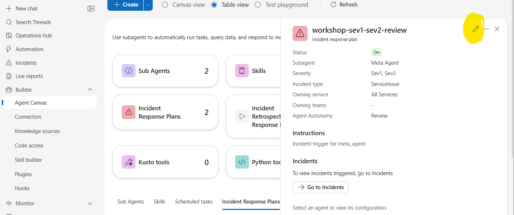
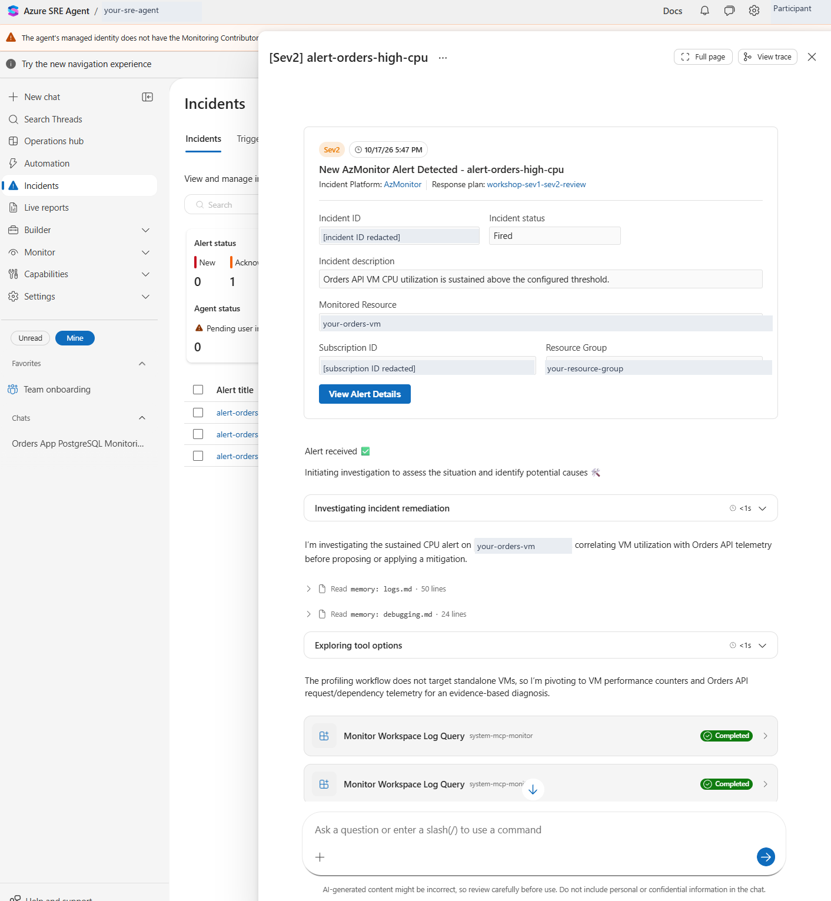
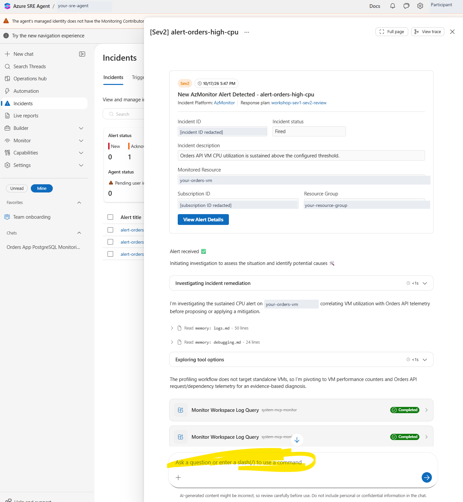

<ul class="sre-meta">
<li class="duration">Estimated time: 40 minutes</li>
<li>Module 02</li>
<li class="incident">Incident 1 of 2</li>
</ul>

## Learning objective

By the end, you can configure how the SRE Agent receives alerts, compare its
speed and accuracy with your own investigation of a high-CPU alert, and confirm
recovery.

## How we'll achieve it

You check the agent's response plan, then make your VM busy for ten minutes.
While the alert is pending, you start your own investigation. When the agent
finishes, you compare its answer and timing with yours, then reset the fault.
You are changing SRE settings, not deploying infrastructure.

### What changes

The fault starts two CPU workers on your VM through Azure VM Run Command. It
stops after ten minutes, uses at most 256 MiB of memory, and runs at low
priority. It does not change PostgreSQL.

## Tasks

### Task 1: Check the response-plan settings

A response plan tells the agent which alerts to investigate and how much it may
do on its own.

1. Open your SRE Agent. Go to **Builder > Agent Canvas**, select **Table view**,
   open the **Incident Response Plans** tab, and open `workshop-sev1-sev2-review`.

    In the response-plan details panel, select the **pencil (Edit) icon** at the
    top right to open the settings.

    

    *Select the highlighted pencil (Edit) icon before checking the settings table.*

    Check these settings in the editor. Correct anything that differs and select
    **Save**:

    | Section | Setting | Value |
    | --- | --- | --- |
    | Response plan details | Incident response plan name | `workshop-sev1-sev2-review` |
    | Response plan details | Severity | Sev1, Sev2 |
    | Response plan details | Title contains | `alert-orders-h` |
    | Response plan details | Title does not contain | Empty |
    | Subagent | Response subagent | Meta Agent |
    | Subagent | Agent autonomy level | Review |
    | Subagent | Alert reinvestigation cooldown | Leave as deployed |

    * **Response subagent:** who investigates. **Meta Agent** is the main agent.
    * **Agent autonomy level:** **Review** means the agent diagnoses, then acts
      only after you approve. This fault needs no remediation, so Review is enough.

    

2. Check the **Incidents preview**. You may see a past incident from the
   facilitators' testing; ignore it.
3. Back in the Azure portal, open your resource group and search for
   `alert-orders-high-cpu`. Alternatively, search **Monitor** and open
   **Alerts > Alert rules**, filtered to your resource group. Check that the
   rule is enabled, is Sev2, and evaluates a five-minute average every minute,
   firing when average CPU is above 80 percent. This is the alert the SRE Agent
   listens for when you trigger the first controlled incident.

    

### Task 2: Check the starting state

1. In your Orders GUI, select **Refresh status** and **Refresh orders**. Liveness
   and Readiness should show HTTP 200 and PostgreSQL should show Ready. Keep that
   tab visible. Note the normal response time.
2. Look at the CPU graph in Task 3 below and note the healthy CPU range. If
   samples have not arrived yet, select **Refresh now** and allow a few minutes
   for Azure Monitor to return data before starting the fault.

### Task 3: Start the CPU fault

1. Select **Run CPU incident** once. The launcher immediately shows **Starting
   CPU fault**, an elapsed timer, and the current progress stage. Azure VM Run
   Command can take a few minutes to confirm the request; the workers may
   already be running during that wait. Do not select Run again.

    **Elapsed** measures time since you selected Run, not the workers' remaining
    runtime.

    The fault starts two background processes on your VM that each keep one CPU
    core fully busy for ten minutes, pushing CPU usage above the alert threshold.

    <div data-sre-incident="cpu">
    <p><strong>JavaScript is required for the launcher.</strong> If it is unavailable, ask your facilitator.</p>
    </div>

2. Follow the launcher's progress: **Start CPU fault**, **Observe CPU telemetry**,
   then **Check Azure alert**. **CPU fault confirmed** means Azure verified the
   workers started, not that the alert has fired.

    The graph shows one-minute average CPU samples and checks for new data
    **every 15 seconds**. Its **Live** badge and **Next in ...s** countdown show
    when it will refresh automatically. Select **Refresh now** beside the graph
    whenever you want to check for newer data, including while the start request
    is pending. **Updated** is the time of the
    last successful refresh; **Latest sample** is the time of the newest metric
    Azure returned. New samples can take a few minutes to arrive, so refreshing
    does not always change the graph.

    !!! info "High CPU on the graph is not a fired alert"
        A one-minute sample above the 80% line is an early signal. The alert
        evaluates a **five-minute average every minute**, so it can take about
        **5 to 10 minutes after the fault starts** to fire. The launcher guides
        you to check alert history; it does not read the alert's status. Continue
        to Task 4 and investigate while Azure collects evidence.

    !!! warning "Check before retrying"
        A timed-out request may still have started the fault. Check the CPU
        graph and your Orders GUI before trying again. Do not start the PostgreSQL
        fault at the same time.

### Task 4: Race the agent

The alert uses a five-minute average, so it fires a few minutes after CPU rises.
Use the wait to investigate on your own.

1. In the Orders GUI, select **Refresh orders** a few times. Note any slower
   response, timeout, or failure. Requests may still succeed; high CPU does not
   guarantee an outage.
2. Set a five-minute timer. Without the agent, find what is wrong. In your
   resource group, search for `virtual` and open your VM.

    

    In the left menu, under **Monitoring**, select **Metrics**. Set the metric
    to **Percentage CPU** with **Avg** aggregation. Also check the **Activity
    log**.

    

3. Go back to the Azure portal and open your resource group. Search for
   `alert-orders-high-cpu` and open it, or search **Monitor** in the top bar and
   open **Alerts**. The alert takes approximately 5 to 10 minutes to fire after
   you start the fault.

    

    Select **History** on the `alert-orders-high-cpu` resource to see when it
    fired. This history confirms whether the **alert** fired; a high CPU sample
    alone does not. The SRE Agent receives the incident after Azure Monitor
    fires the alert.

    

    !!! note "No fired alerts in History yet?"
        An empty history is expected while the five-minute average builds up.
        Allow about **5 to 10 minutes from starting the CPU fault**, then select
        **Refresh** in the Azure portal. Check that the time range includes this
        exercise and that you opened `alert-orders-high-cpu` for your assigned
        VM. Do not start another CPU fault to populate the list. If it is still
        empty after that wait, confirm the rule is enabled and compare the VM's
        **Percentage CPU** metric using **Avg** and a **five-minute** time
        granularity. An alert already in **Fired** state does not fire again
        until it resolves. Ask your facilitator if the rule or metrics do not
        match the expected state.

4. Go to the SRE Agent portal and open **Incidents**, or select **Open SRE Agent
   incidents** below the launcher. Look for an incident titled for the
   `alert-orders-high-cpu` alert. This can take 5 to 10 minutes after the alert
   fires. Open it and watch its tool calls and findings appear. It may update an
   existing thread.

    

    !!! tip "Alert history and agent incidents are separate checkpoints"
        If **Incidents** is empty, first confirm the alert has fired in Azure
        Monitor **History**. Then allow time for the agent to receive it and
        refresh **Incidents**. A high CPU graph alone does not mean an incident
        is available yet.

### Task 5: Check the agent's explanation

Return to your **SRE Agent portal**, not the Azure Monitor alert page or the
Orders GUI. Select **Open SRE Agent incidents** below the CPU graph, or open
your agent and select **Incidents** in the left menu.

The response plan runs in **Review** mode. This fault is controlled and stops
itself after ten minutes, so there is nothing for the agent to fix. You are
checking that the agent recognises it as a controlled fault, not that it
remediates anything.

1. In **Incidents**, select the `alert-orders-high-cpu` incident for this
   exercise. Open its incident thread and read the agent's findings below the
   alert details. Compare them with what you saw in Task 4: the CPU metrics, the
   Activity log, and the alert. Note what the agent found that you missed, and
   whether it identified the fault as controlled.

    

    *Open the CPU incident from Incidents, then read the investigation below its
    alert details. Account and resource identifiers are redacted; your incident
    time will differ.*

    !!! note "The agent may ask for approval"
        The agent may suggest running a command to check that the CPU fault is
        still running. Trust your judgement on whether or not this is the right
        call.

2. Compare the CPU you observed with the documented baseline. Your facilitator
   uploaded knowledge files that give the agent baselines for the Orders app. In
   the **same incident thread**, scroll to the message box at the bottom, enter
   this question, and select the **Send arrow**:

    ```text
    How does the CPU you observed compare with the documented baseline and
    alert threshold? Name the document you used.
    ```

    

    *Use the highlighted message box in the existing CPU incident, not New chat,
    so the question keeps the incident's context.*

    The baselines are fictitious Contoso Retail demo values. Check which numbers
    come from the document and which come from your telemetry.

### Task 6: Reset CPU

1. Select **Reset incident** in the CPU launcher. In your Orders GUI, select
   **Refresh status** and confirm the app is healthy. The CPU graph should
   start returning toward the healthy range.
2. Refresh orders and status. Watch the newest CPU samples return toward the
   healthy range. The alert resolves after its evaluation window is healthy.
   If the ten-minute fault already expired, still check recovery.
3. Do not start the next incident until the app is healthy.

## Quick check

??? question "Why does the alert arrive after CPU first rises?"
    The rule needs a five-minute average above its threshold. Detection is
    later than the start of the problem.

??? question "Did stopping the fault fix a production CPU problem?"
    No. It ended this exercise. A real incident still needs the offending
    workload, demand, or capacity problem understood.

??? question "What did the agent add compared with your own investigation?"
    Compare your five-minute result with the agent's. Typically it correlates
    metrics, requests, and the Activity log together and cites its evidence. You
    still check its claims.

## Next

[Respond to PostgreSQL connectivity loss :material-arrow-right:](../04-incident-postgresql/index.md){ .md-button .md-button--primary }

<div class="sre-nav" markdown>
[:material-arrow-left: Module 01 - Access and Understand the Workshop](../01-deploy-and-validate/index.md)
[Module 03 - Respond to PostgreSQL Connectivity Loss :material-arrow-right:](../04-incident-postgresql/index.md)
</div>
