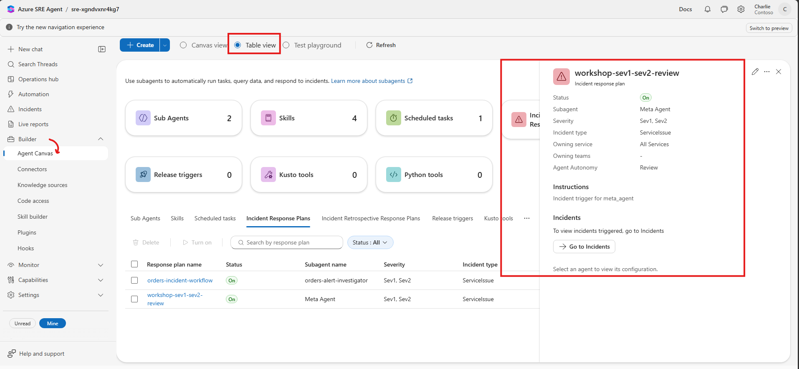
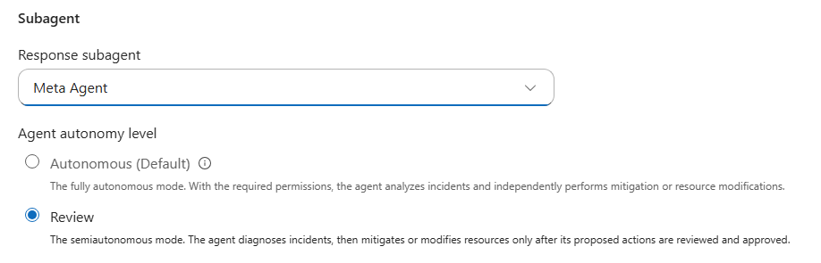
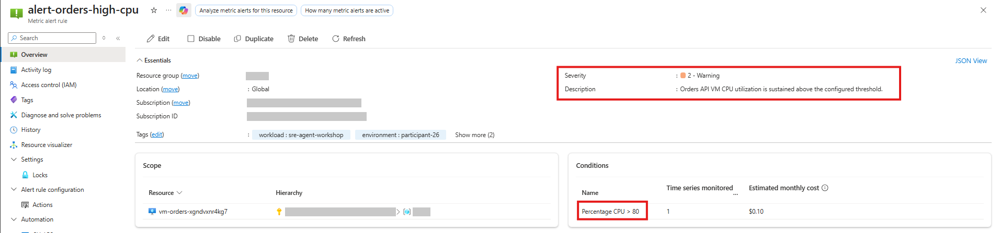
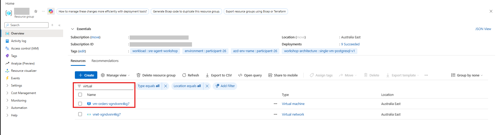
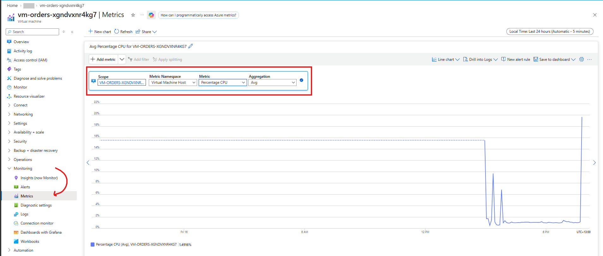
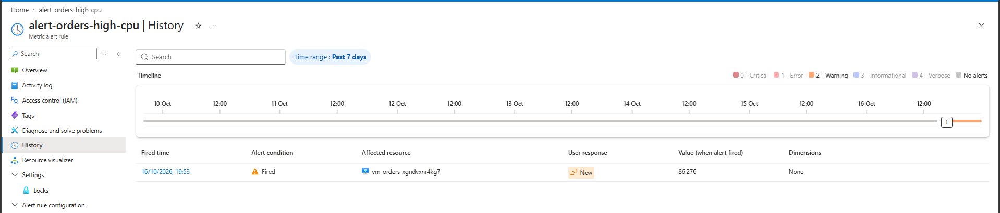
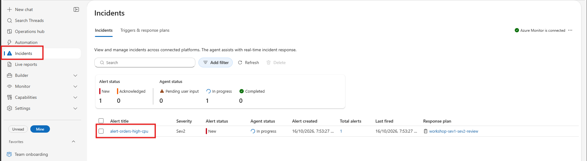

<ul class="sre-meta">
<li class="duration">Estimated time: 40 minutes</li>
<li>Module 02</li>
<li class="incident">Incident 1 of 2</li>
</ul>

## Learning objective

By the end, you can configure how the SRE Agent receives alerts, compare its
speed and accuracy with your own investigation of a high-CPU alert, and confirm
recovery.

## How we'll achieve it

You check the agent's response plan, then make your VM busy for ten minutes.
While the alert is pending, you start your own investigation. When the agent
finishes, you compare its answer and timing with yours, then reset the fault.
You are changing SRE settings, not deploying infrastructure.

### What changes

The fault starts two CPU workers on your VM through Azure VM Run Command. It
stops after ten minutes, uses at most 256 MiB of memory, and runs at low
priority. It does not change PostgreSQL.

## Tasks

### Task 1: Check the response-plan settings

A response plan tells the agent which alerts to investigate and how much it may
do on its own.

1. Open your SRE Agent. Go to **Builder > Agent Canvas**, select **Table view**,
   open the **Incident Response Plans** tab, and open `workshop-sev1-sev2-review`.

    

    Check these settings. Correct anything that differs and select **Save**:

    | Section | Setting | Value |
    | --- | --- | --- |
    | Response plan details | Incident response plan name | `workshop-sev1-sev2-review` |
    | Response plan details | Severity | Sev1, Sev2 |
    | Response plan details | Title contains | `alert-orders-h` |
    | Response plan details | Title does not contain | Empty |
    | Subagent | Response subagent | Meta Agent |
    | Subagent | Agent autonomy level | Review |
    | Subagent | Alert reinvestigation cooldown | Leave as deployed |

    * **Response subagent:** who investigates. **Meta Agent** is the main agent.
    * **Agent autonomy level:** **Review** means the agent diagnoses, then acts
      only after you approve. This fault needs no remediation, so Review is enough.

    

2. Check the **Incidents preview**. You may see a past incident from the
   facilitators' testing; ignore it.
3. Back in the Azure portal, open your resource group and search for
   `alert-orders-high-cpu`. It's the first resource, as its name starts with an
   "a". Alternatively, search **Monitor** and open **Alerts > Alert rules**,
   filtered to your resource group. Check the rule is enabled, Sev2, and fires
   when average CPU is above 80 percent for five minutes. This is what the SRE
   Agent listens for when we trigger the first controlled incident.

    

### Task 2: Check the starting state

1. In your Orders GUI, select **Refresh status** and **Refresh orders**. Liveness
   and Readiness should show HTTP 200 and PostgreSQL should show Ready. Keep that
   tab visible. Note the normal response time.
2. Look at the CPU graph below and note the healthy CPU range.

### Task 3: Start the CPU fault

1. Select **Run CPU incident**. It may take a couple of minutes to show in the
   graph below. This starts two background processes on your VM that each keep
   one CPU core fully busy for ten minutes, pushing CPU usage above the alert
   threshold.

    <div data-sre-incident="cpu">
    <p><strong>JavaScript is required for the launcher.</strong> If it is unavailable, ask your facilitator.</p>
    </div>

2. Watch the graph, which shows average CPU in one-minute intervals and
   refreshes automatically. You should see CPU rise above the alert threshold.

    !!! warning "Check before retrying"
        A timed-out request may still have started the fault. Check the CPU
        graph and your Orders GUI before trying again. Do not start the PostgreSQL
        fault at the same time.

### Task 4: Race the agent

The alert uses a five-minute average, so it fires a few minutes after CPU rises.
Use the wait to investigate on your own.

1. In the Orders GUI, select **Refresh orders** a few times. Note any slower
   response, timeout, or failure. Requests may still succeed; high CPU does not
   guarantee an outage.
2. Set a five-minute timer. Without the agent, find what is wrong. In your
   resource group, search for `virtual` and open your VM.

    

    In the left menu, under **Monitoring**, select **Metrics**. Set the metric
    to **Percentage CPU** with **Avg** aggregation. Also check the **Activity
    log**.

    

3. Go back to the Azure portal and open your resource group. Search for
   `alert-orders-high-cpu` and open it, or search **Monitor** in the top bar and
   open **Alerts**. The alert takes approximately 5 to 10 minutes to fire after
   you start the fault.

    

    Select **History** on the `alert-orders-high-cpu` resource to see when it
    fired. This history is the source of truth for the fault: the agent only sees
    the incident once the alert fires here.

    
4. Go to the SRE Agent portal and open **Incidents**, or select **Open SRE Agent
   incidents** below the launcher. Look for an incident titled for the
   `alert-orders-high-cpu` alert. This can take 5 to 10 minutes after the alert
   fires. Open it and watch its tool calls and findings appear. It may update an
   existing thread.

    

### Task 5: Check the agent's explanation

The response plan runs in **Review** mode. This fault is controlled and stops
itself after ten minutes, so there is nothing for the agent to fix. You are
checking that the agent recognises it as a controlled fault, not that it
remediates anything.

1. Open the incident thread and read the agent's findings. Compare them with
   what you saw in Task 4: the CPU metrics, the Activity log, and the alert.
   Note what the agent found that you missed, and whether it identified the fault
   as controlled.

    !!! note "The agent may ask for approval"
        The agent may suggest running a command to check that the CPU fault is
        still running. Trust your judgement on whether or not this is the right
        call.

2. Compare the CPU you observed with the documented baseline. Your facilitator
   uploaded knowledge files that give the agent baselines for the Orders app. In
   the incident thread, ask:

    ```text
    How does the CPU you observed compare with the documented baseline and
    alert threshold? Name the document you used.
    ```

    The baselines are fictitious Contoso Retail demo values. Check which numbers
    come from the document and which come from your telemetry.

### Task 6: Reset CPU

1. Select **Reset incident** in the CPU launcher. In your Orders GUI, select
   **Refresh status** and confirm the app is healthy. The CPU graph should
   start returning toward the healthy range.
2. Refresh orders and status. Watch the newest CPU samples return toward the
   healthy range. The alert resolves after its evaluation window is healthy.
   If the ten-minute fault already expired, still check recovery.
3. Do not start the next incident until the app is healthy.

## Quick check

??? question "Why does the alert arrive after CPU first rises?"
    The rule needs a five-minute average above its threshold. Detection is
    later than the start of the problem.

??? question "Did stopping the fault fix a production CPU problem?"
    No. It ended this exercise. A real incident still needs the offending
    workload, demand, or capacity problem understood.

??? question "What did the agent add compared with your own investigation?"
    Compare your five-minute result with the agent's. Typically it correlates
    metrics, requests, and the Activity log together and cites its evidence. You
    still check its claims.

## Next

[Respond to PostgreSQL connectivity loss :material-arrow-right:](../04-incident-postgresql/index.md){ .md-button .md-button--primary }

<div class="sre-nav" markdown>
[:material-arrow-left: Module 01 - Access and Understand the Workshop](../01-deploy-and-validate/index.md)
[Module 03 - Respond to PostgreSQL Connectivity Loss :material-arrow-right:](../04-incident-postgresql/index.md)
</div>
