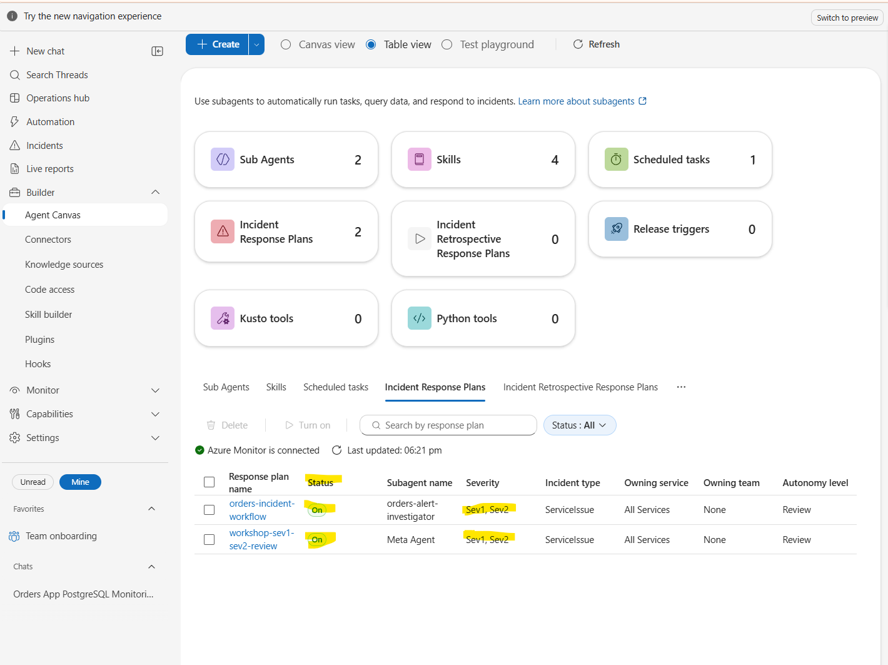
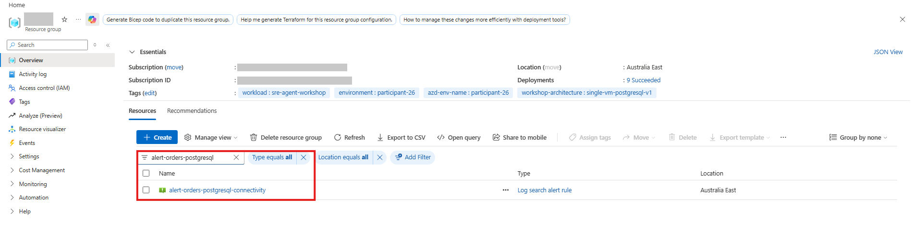
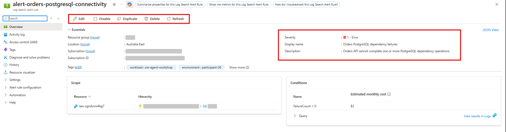
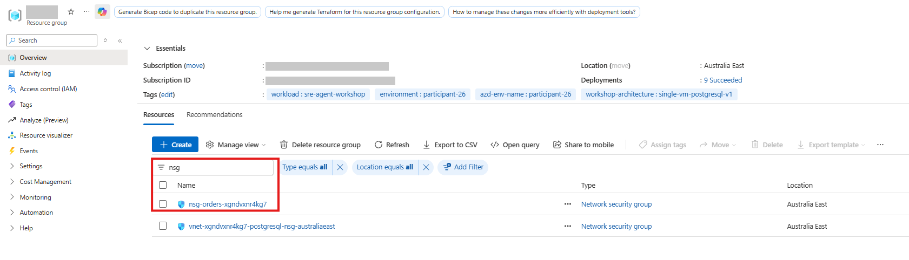
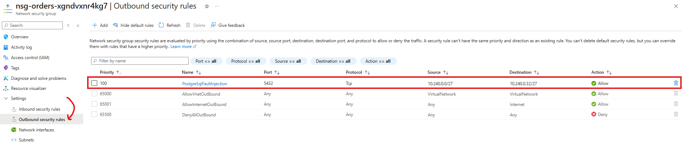
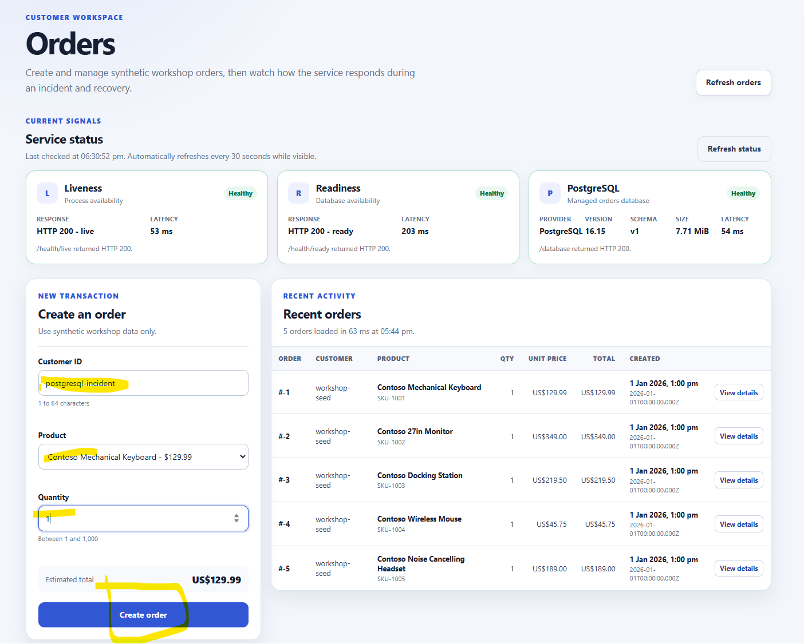
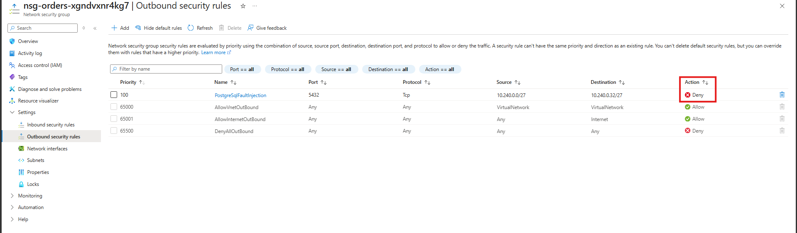
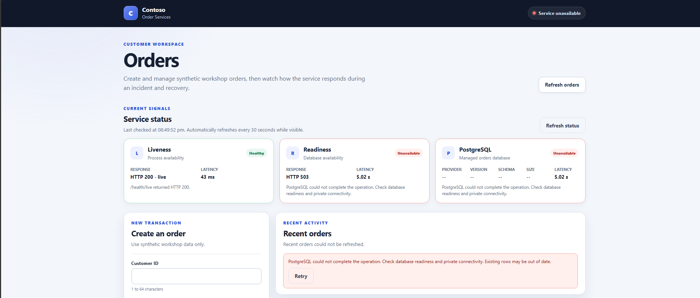
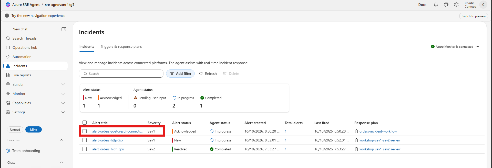
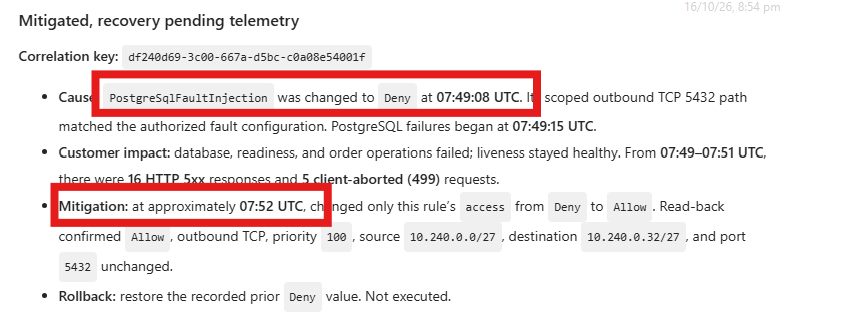

<ul class="sre-meta">
<li class="duration">Estimated time: 45 minutes</li>
<li>Module 03</li>
<li class="incident">Incident 2 of 2</li>
</ul>

## Learning objective

**This fault will be automatically diagnosed and fixed.** The dedicated
PostgreSQL investigator runs in **Autonomous** mode: it identifies the blocked
connection and restores the scoped network rule without asking you for approval.

By the end, you can follow a PostgreSQL connectivity failure from the customer
app to the alert and the dedicated incident investigator, trace how the agent
reasoned and autonomously restored access, check its fix against the network
rule and the app, and use the agent to draft an incident follow-up.

## How we'll achieve it

You block the connection between your Orders VM and PostgreSQL, then watch the
alert wake the investigator. It runs in **Autonomous** mode, so it diagnoses
the cause and fixes it without asking you. You follow its incident thread in the
SRE Agent portal, check each claim and the change it made, confirm your order is
unchanged, and ask the agent to draft the incident follow-up.

### What changes

The fault changes one network security group (NSG) rule. An NSG is Azure's
firewall rule set for a subnet:

| Property | Fixed value |
| --- | --- |
| Name | `PostgreSqlFaultInjection` |
| Direction and protocol | Outbound TCP |
| Source | Orders subnet, `10.240.0.0/27` |
| Destination | PostgreSQL subnet, `10.240.0.32/27`, port `5432` |
| Priority | `100` |
| Access | `Allow` normally; `Deny` during the fault |

An NSG change affects new connections, not established ones. The launcher
therefore restarts only `orders-api` to close its existing database connections.
It does not restart the VM or PostgreSQL, change orders, or block other traffic.

The investigator's fix is narrower still: it sets this one rule back to `Allow`.
It makes no other change and does not restart anything.

## Tasks

### Task 1: Review the SRE and network settings

Two response plans share the work. PostgreSQL alerts go to a dedicated
investigator; everything else stays with the main agent.

1. In your SRE Agent, same as before, go to **Builder > Agent Canvas**, switch to
   **Table view**, then select **Incident Response Plans** to see the two plans.

    

    *Task 1: Use the Incident Response Plans tab to locate both plans. This
    navigation screenshot shows Review for both rows; check the required
    PostgreSQL autonomy setting in step 3 rather than copying that sample value.*

2. Check that both plans are On and handle Sev1 and Sev2. Do not remove either
   title filter.
3. Open `orders-incident-workflow` and select **Edit**. Check that **Agent
   autonomy level** is **Autonomous (Default)**, then close without saving. The
   original plan, `workshop-sev1-sev2-review`, stays on **Review**.
   If the dedicated plan still shows **Review**, ask your facilitator to restore
   its **Autonomous** setting before you inject the fault.
4. Open your resource group, search for `alert-orders-postgresql-connectivity`,
   and open it. Alternatively, search for **Monitor** in the top bar and open
   **Alerts > Alert rules**, filtered to your resource group. Check that the rule
   is enabled and is Sev1. It evaluates the last five minutes every minute and
   fires when it finds at least one failed PostgreSQL dependency.

    

    

5. Look at the network rule the fault will change. Do not edit it.
    1. In your resource group, search for `nsg` and open the network security
       group whose name starts with `nsg-orders-`.

        

    2. In the left menu, under **Settings**, select **Outbound security rules**
       and find the `PostgreSqlFaultInjection` rule.

        

    Once the incident launcher below changes this rule, the VM can no longer
    reach the PostgreSQL database, because the NSG blocks its outbound network
    traffic:

    ```text
    VM -> BLOCKED by NSG -> PostgreSQL
    ```

### Task 2: Save a healthy order

1. In your Orders GUI, select **Refresh status** and **Refresh orders**. All
   three status cards should show healthy results: Liveness HTTP 200, Readiness
   HTTP 200, and PostgreSQL Healthy.
2. Under **Create an order**, enter customer ID `postgresql-incident`, choose a
   product (for example, **Contoso Mechanical Keyboard**), and set **Quantity**
   to `1`. Select **Create order**.

    

    *Task 2: Fill in the synthetic order while all three service-status cards
    are healthy, then select Create order.*

3. Save the returned order ID, product, and quantity. Select **Refresh orders**
   again and confirm that your order appears before injection. You will read
   this same order after recovery.

### Task 3: Block the database connection

!!! info "A few minutes of waiting is expected"
    Starting the fault, seeing failed samples, and receiving the alert are
    separate stages. A wait of around three minutes is not, by itself, a failed
    request. Watch the launcher's current step and elapsed time rather than
    clicking **Block PostgreSQL access** again.

| Stage | What you will see | What to do |
| --- | --- | --- |
| Apply and verify the fault | The launcher shows steps 1 to 3: check the VM, set the rule to `Deny`, then recycle only `orders-api` and verify the expected HTTP results. Azure operations can take several minutes. | Keep this page open. Wait for **Fault confirmed** or an explicit error; do not start another fault. |
| Wait for monitoring | The graph refreshes automatically, but new PostgreSQL samples can arrive several minutes late. The **Fault requested** marker records your click, not the alert firing. | Read the newest **Sample time**. A value above zero means failed database calls, not confirmation of an alert or agent activity. |
| Follow diagnosis and repair | Azure Monitor evaluates failures from the last five minutes every minute. After the alert fires and reaches the agent, the investigator diagnoses and restores access automatically. | Select **Open alert rule** and check **History**, then **Open SRE Agent incidents**. Continue to Task 4 without waiting for the whole graph to turn healthy. |

1. Select **Block PostgreSQL access** once. The fault and reset buttons stay
   disabled while the Azure operation is running. The current step, an activity
   indicator, and elapsed time show that the launcher is still working. You can
   select **Refresh now** beside the graph to read newer telemetry without
   submitting the fault again.

    <div data-sre-incident="postgresql">
    <p><strong>JavaScript is required for the launcher.</strong> If it is unavailable, ask your facilitator.</p>
    </div>

    !!! tip "The agent may already have restored access"
        The agent can finish its repair before you check the rule or switch to
        the Orders GUI. If the rule is already `Allow` or the app has recovered,
        do not inject the fault again just to reproduce the screenshots.
        Continue to Task 4 and use the incident thread and Activity log to
        verify what happened.

2. When the launcher reports **Fault confirmed**, navigate back to the same NSG
   as above (`nsg-orders-…`) and open **Outbound security rules**. Check that
   `PostgreSqlFaultInjection` has changed to **Deny**.

    

3. Select **Open Orders GUI**, then **Refresh status** and **Refresh orders**.
   While the rule is `Deny`, liveness stays healthy (HTTP 200), but Readiness,
   PostgreSQL, and order operations fail (HTTP 503). The database server is still
   running; the app cannot reach it.

    

4. Return to the launcher and check the newest graph samples. Select
   **Open alert rule**, then **History**, to confirm when
   `alert-orders-postgresql-connectivity` fired. A graph crossing the alert
   line is not a substitute for this check. Select **Open SRE Agent incidents**
   and continue to Task 4.

    !!! warning "Still waiting, or the launcher reported an error?"
        If the alert or incident has not appeared ten minutes after **Fault
        confirmed**, check the alert history and the Task 1 settings, then ask
        your facilitator or use
        [fault troubleshooting](../30-appendix/02-troubleshooting.md#fault-controls).
        This is a troubleshooting checkpoint, not a guaranteed completion time.
        An interrupted operation may still have changed the rule. Check the rule
        and app before retrying; use **Reset incident** if you need to abandon
        the exercise safely.

### Task 4: Follow the agent's reasoning and fix

The agent does not wait for approval. By the time you navigate to the agent's
thread on this issue, it may have already fixed the Contoso Orders system.

1. In the SRE Agent portal, open **Incidents** and select the
   `alert-orders-postgresql-connectivity` incident.

    

2. Read the agent's summary in the incident thread. It shows when the rule was
   changed and when the agent restored it, so you can see how quickly it fixed
   this.

    

3. If needed, ask:

    ```text
    Summarize what you did for this PostgreSQL connectivity alert: the response
    plan and handling agent, the evidence for the cause, the exact change you
    made and its rollback, and how you verified recovery.
    ```

    ??? info "Optional: use the escalation and communications document"
        If your facilitator uploaded the knowledge files, ask:

        ```text
        Using our escalation and communications document, give the severity,
        who to notify, and a draft stakeholder email for this incident. Do not
        send or create anything.
        ```

        The company, contacts and templates are fictitious demo data. Check that
        the facts in the draft come from this incident's evidence, not from the
        document's worked example.

4. Check the agent's claims in the portal:
    * PostgreSQL still shows **Ready**, with public access disabled.
    * `PostgreSqlFaultInjection` now shows `Allow`; its other settings are
      unchanged.
    * **Activity log** shows two writes to the rule: the fault injection, then
      the agent's restore under its managed identity.
    * No VM, PostgreSQL, or other NSG rule was changed.
5. Compare the explanation with the evidence. The deliberate API restart closes
   old connections; the denied network rule caused the outage. Note
   one agent claim you checked, and the result. Mark any claim the evidence does
   not support.

??? info "Optional stretch: audit the autonomy boundary"
    The agent may change only this one rule. Ask:

    ```text
    List every Azure write you made for this incident and every action you chose
    not to take, such as restarting orders-api or the VM. Explain why each was
    out of scope.
    ```

    Compare the answer with the Activity log. Note how the narrow change and its
    recorded rollback keep an autonomous fix safe.

### Task 5: Confirm recovery

1. Note the time of the agent's rule restore. In the Orders GUI, select
   **Refresh status** and **Refresh orders**. All three status cards should recover.
2. Open the order you saved in Task 2 and check its product and quantity.
3. Check that the latest database calls succeed and wait for the alert to
   resolve. Old failures remain visible in the chart; they are incident
   history.
4. Open the network security group's **Outbound security rules** again and check
   that `PostgreSqlFaultInjection` is back to `Allow`.
5. Note the time the app looked healthy again.
6. If the agent has not restored the rule, or telemetry has not recovered after
   a reasonable wait, ask it why in the thread. As a last resort, select
   **Reset incident** in the launcher. If reset
   fails, check the Orders GUI and use
   [fault troubleshooting](../30-appendix/02-troubleshooting.md#fault-controls)
   or ask your facilitator. Leave no database fault active.

### Task 6: Draft the follow-up

After an incident, someone writes the issue and the summary email. The
investigator has skills for both. In this workshop they only produce drafts.

1. In the incident thread, ask:

    ```text
    Use orders-github-issue-followup to draft a GitHub issue for this incident,
    and orders-email-incident-followup to draft a summary email. Draft only: do
    not publish or send anything. Include a UTC timeline, customer impact, the
    cause, the evidence, the change you made, and the recovery step.
    ```

2. Check each draft against what you observed:
    * The fault, alert, agent restore, and recovery times match the alert history
      and your notes.
    * The cause and impact match what you verified in Task 4.
    * It contains no credentials, tokens, or real customer data.
3. Confirm nothing was sent or created. The classroom setup binds no GitHub
   repository or Outlook recipient, so the agent should say what is missing.
   Publishing would need a separate request and your approval.
4. Edit one sentence you would change before sharing the draft. Keep the drafts
   with your notes.

## Check before moving on

* [ ] Only the documented rule's access changed, and the agent made that change.
* [ ] The PostgreSQL alert reached `orders-incident-workflow` and
      `orders-alert-investigator`, running in Autonomous mode.
* [ ] Any HTTP 5xx alert remained on the original response plan.
* [ ] You traced the agent's observe, hypothesize, confirm, act, and verify steps
      and checked its claims against the rule and app.
* [ ] Access is `Allow`, the app is healthy, and your order is unchanged.
* [ ] You reviewed the follow-up drafts, and nothing was sent.

## Quick check

??? question "Why can liveness stay green during this outage?"
    The API process is running, but it cannot reach PostgreSQL. Liveness alone
    does not prove that customers can place orders.

??? question "Why not stop the database instead?"
    That would be a different incident. This exercise isolates one connection
    and leaves the database and its data intact.

??? question "Why can both response plans stay enabled?"
    Their scalar title filters are complementary. PostgreSQL titles match the
    dedicated plan; CPU and HTTP 5xx titles match the original plan.

??? question "Why is it safe to let this agent fix the rule without approval?"
    Its autonomy is bounded: one Azure change to one named rule, a recorded
    rollback, no restarts, and verification from fresh telemetry. The original
    plan stays in Review for everything else.

??? question "What did the dedicated investigator and its drafts save you?"
    It gathered evidence across the app, network, and Activity log, then turned
    it into a timeline and a ready-to-edit issue and email. You still verified
    the facts and decided what to publish.

## Next

[Deploy and evaluate proactive SRE checks :material-arrow-right:](../05-scheduled-health-check/index.md){ .md-button .md-button--primary }

<div class="sre-nav" markdown>
[:material-arrow-left: Module 02 - Configure SRE and Respond to High CPU](../03-incident-high-cpu/index.md)
[Module 04 - Deploy and Evaluate Proactive SRE Checks :material-arrow-right:](../05-scheduled-health-check/index.md)
</div>
