<ul class="sre-meta">
<li class="duration">Estimated time: 45 minutes</li>
<li>Module 04</li>
<li>Hands-on</li>
</ul>

## Learning objective

By the end, you can set up a scheduled SRE health check, run it, verify its
findings against independent evidence, generate a Live Report from a prompt,
and use the agent to compare incidents.

## How we'll achieve it

The first two exercises started investigations from alerts. Now you add a
scheduled check that can report problems without waiting for an alert, run it,
and check its findings. You then generate a Live Report from the same
telemetry and compare it with the logs. This exercise introduces no new fault.
Use the recovered environment from Module 03.

### What you configure

Your facilitator has prepared the `proactive-health-check` skill, the
`health-report-investigator` custom agent, and the `orders-daily-health-report`
scheduled task. You check the task and run it, then generate the
**Orders Service Health** Live Report yourself. The
[setup guide](../30-appendix/08-proactive-extensions.md) describes how
facilitators install the prepared components.

The skill describes what to measure and how to report it. The task supplies
the prompt and schedule. The Live Report is a separate saved view that you
create from a prompt and then reload.

## Tasks

### Task 1: Check the app and read the procedure

1. Refresh orders and status in the Orders GUI. Both faults should already be
   reset. Keep that tab visible so requests continue while you work.
2. Open your SRE Agent's **Connectors** page. Its Log Analytics and Application
   Insights connectors should be healthy and refer to your environment.

    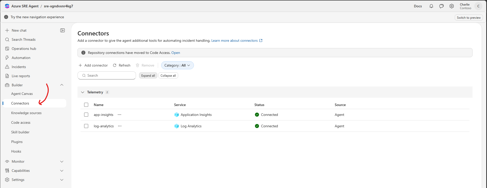

3. Read the health-check skill. Either click the
   [health-check skill](https://github.com/charliekw411/sre-agent-workshop/blob/main/agent/skills/proactive-health-check/SKILL.md)
   link to view it in the lab repo, or open it in the SRE portal itself: go to
   **Builder > Agent Canvas**, switch to **Table view**, open the **Skills** tab,
   select `proactive-health-check`, and select the pencil icon to see its full
   text. Close it without saving.
   Focus on its **Procedure**, **Status rubric**, and **Safety** sections:
    * It checks the API, PostgreSQL, and VM.
    * It separates the current state from earlier incidents.
    * No samples means **Unknown**, not **Healthy**.
    * It reports findings without changing resources.

    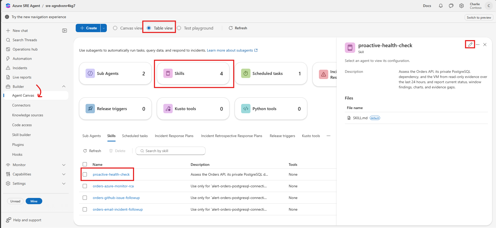

    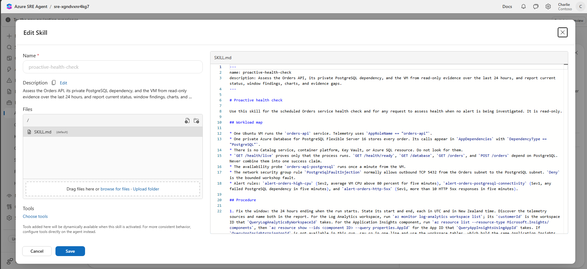

4. If the skill, custom agent, or connectors are missing, ask your facilitator
   before continuing.

### Task 2: Check the task configuration

1. In the left menu, open **Builder > Agent Canvas**, switch to **Table view**,
   and open the **Scheduled tasks** tab.
2. Open `orders-daily-health-report` and verify its settings against these
   screenshots. This task was pre-deployed for your environment, so you don't
   need to create it. Close it without saving.

    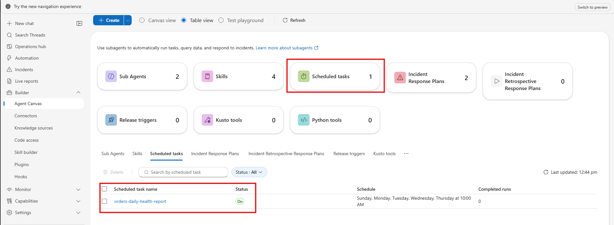

    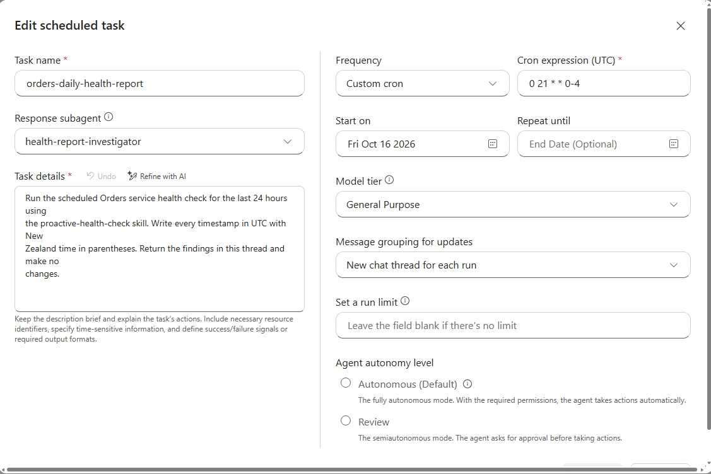

3. Run it now. In the left menu, open **Automation**, select the checkbox next to
   `orders-daily-health-report`, and select **Run now**.

    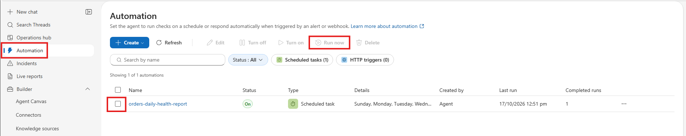

    Then open **Search Threads** and select the most recent thread labeled
    **scheduled task**.

    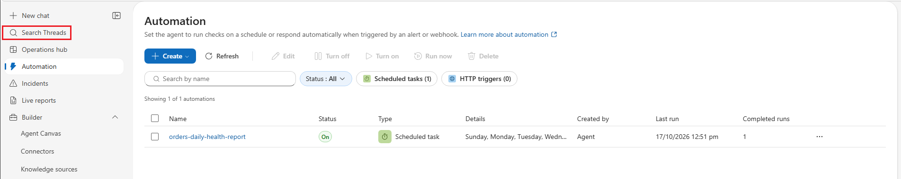

4. Note the schedule: it runs on weekdays at 09:00 New Zealand Standard Time,
   or 10:00 during daylight time. You are running it now rather than waiting for
   that schedule. Each run uses Azure Agent Units; turn the task off when you
   finish.

### Task 3: Watch the agent

1. In the scheduled task thread, watch the agent gather records, chart them, and
   write its findings.
2. Check that the thread includes:
    * The queried environment and time window
    * Current API, PostgreSQL, and VM status
    * Earlier CPU and PostgreSQL incidents, if they fall within the window
    * Missing data and any lack of a historical baseline
    * Sources for the important claims
3. Read the tool-call cards. Calls that read your environment must be queries,
   read-only Azure commands, or charts. Decline any request to change
   resources, send messages, or create issues.

    !!! note "Check what the run actually used"
        The custom agent's tool list does not guarantee which tools a scheduled
        run uses. Check the calls in the thread. If the Application Insights
        query tool is unavailable, use the same records in Log Analytics.

### Task 4: Check the findings yourself

1. Navigate back to the Azure portal and search for **Log Analytics** in your
   resource group. Open the workspace.

    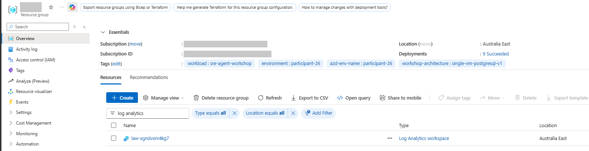

    In the left menu, select **Logs**. As in Module 01, close the **Queries hub**
    pop-up, turn **Agent** off, and set the mode dropdown to **KQL mode**.

    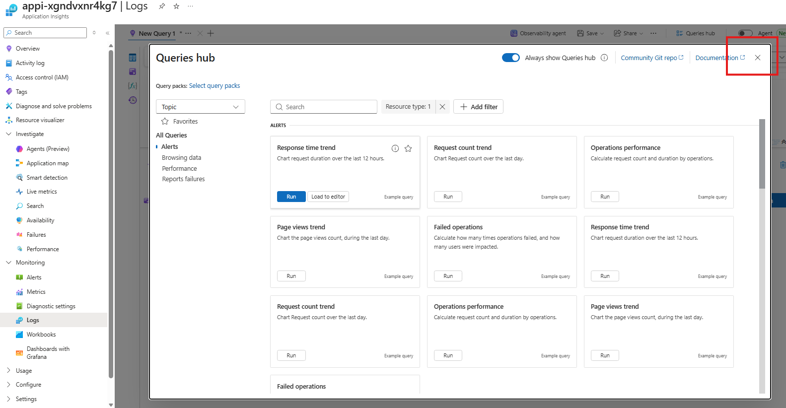

    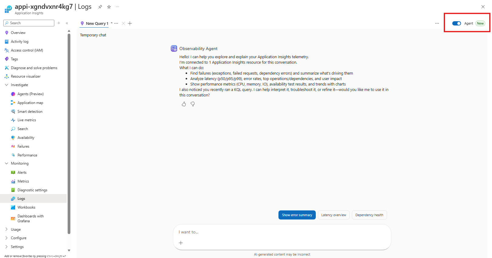

    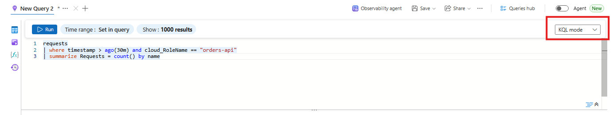

    Paste this query and select **Run**. For the last 15 minutes, it shows how
    many requests the Orders API handled, how many failed, and the P95 response
    time (95 percent of requests were faster than this):

    ```kusto
    AppRequests
    | where TimeGenerated > ago(15m) and AppRoleName == "orders-api"
    | extend Samples = tolong(coalesce(ItemCount, 1))
    | summarize Requests = sum(Samples),
        Failed = sumif(Samples, Success == false),
        P95Ms = round(percentile(DurationMs, 95), 1)
      by Name
    ```

    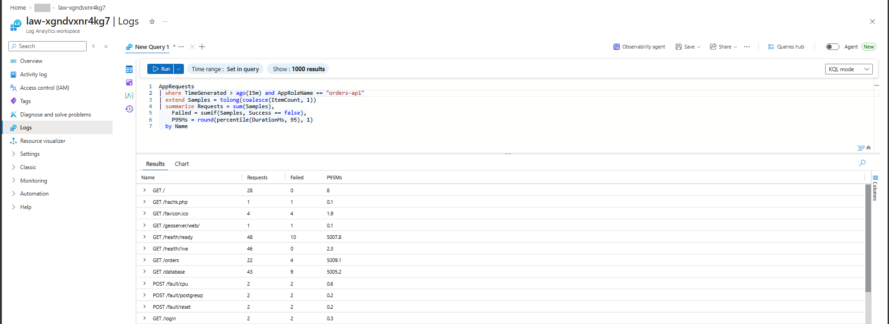

2. Now check the database calls. Replace the query with this one. It shows how
   many calls the Orders API made to PostgreSQL in the last 15 minutes, and how
   many failed:

    ```kusto
    AppDependencies
    | where TimeGenerated > ago(15m) and AppRoleName == "orders-api"
    | where DependencyType == "PostgreSQL"
    | extend Samples = tolong(coalesce(ItemCount, 1))
    | summarize Calls = sum(Samples), Failed = sumif(Samples, Success == false)
    ```

    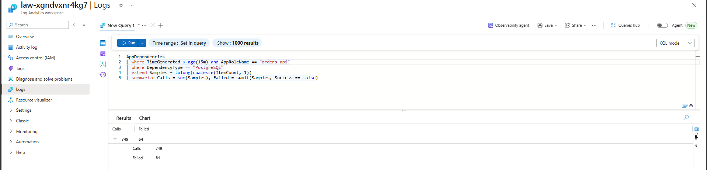

3. Compare these results with the agent's report. Do the request and database
   numbers look right? The agent's report covers the last 24 hours, so its
   totals will be higher than these 15-minute results.

### Task 5: Generate and check the Live Report

1. Keep recent Orders traffic running by refreshing orders and status in the
   Orders GUI.
2. In the left menu, open **Live reports**, then select **+ New report**. There
   is no existing report, so you create it.

    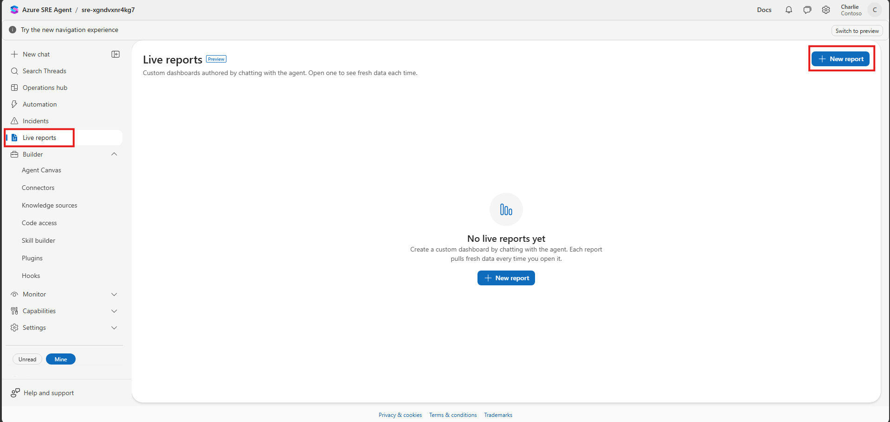

3. The agent opens an authoring thread and asks for a **Report focus** with 3
   options. Don't pick one. Paste this custom prompt into the response box
   instead and send it. It tells the agent what the report must show and which
   status rules to use:

    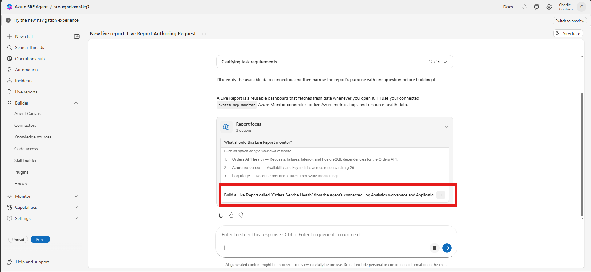

    ```text
    Build a Live Report called "Orders Service Health" from the agent's
    connected Log Analytics workspace and Application Insights data. Cover the
    last 24 hours with a time-range selector. Show New Zealand time
    (Pacific/Auckland) computed with datetime_utc_to_local as plain text such as
    2026-10-13 10:47, without a UTC offset suffix. Label the zone and keep UTC
    available in a tooltip or secondary column.

    Include:
    1. Orders API request volume, success rate, and P95 duration by operation
       from AppRequests where AppRoleName is "orders-api". Show GET /health/live
       separately from the database-backed operations.
    2. PostgreSQL dependency calls, failure percentage, and P95 duration from
       AppDependencies where DependencyType is "PostgreSQL".
    3. Database availability results from AppAvailabilityResults where Name is
       "orders-api-postgresql".
    4. VM heartbeat continuity from Heartbeat and guest CPU from Perf where
       CounterName is "% Processor Time".
    5. A status indicator for each area, computed only from the last 15 minutes
       and independent of the selected window:
       - No data: no samples in the last 15 minutes. Never show Healthy
         without samples.
       - Unhealthy: any failed request, PostgreSQL dependency call, or
         availability check; average guest CPU above 80 percent; or a
         heartbeat gap longer than 5 minutes.
       - Degraded: no failures, but P95 duration above 1,000 ms.
       - Healthy: samples exist and none of the above applies.
       Show the selected-window numbers beside each status. A failure earlier
       in the window that has recovered is a window finding, not the current
       status.
    6. A short list of missing data.

    Use read-only queries only. Do not add model-assisted analysis, buttons, or
    any tool that changes Azure resources, sends email, or creates issues.
    ```

4. Watch the agent build the report. When it asks you to approve a tool,
   approve only the read-only workspace query tool (`system-mcp-monitor` in
   testing). Decline any request to change Azure resources, send messages, or
   create issues.
5. Wait for the agent to finish. Once it's done, the report shows up on the
   **Live reports** page. Open it and compare what it shows with the data in the
   Orders GUI.

    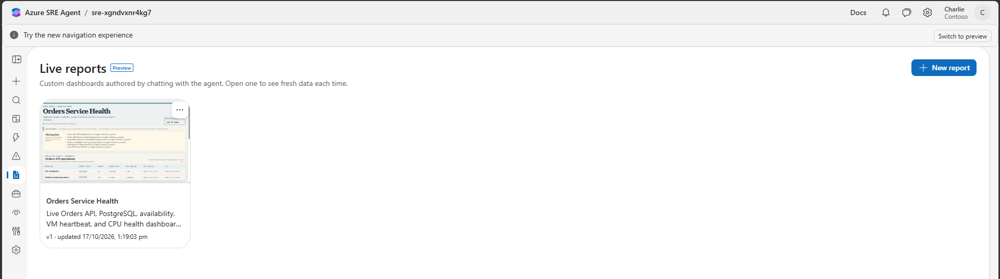

!!! note "Report creation uses agent units"
    Creating and updating a report uses agent units. Update the existing
    report rather than creating copies.

### Task 6: Compare the exercises

1. Select **New chat** in the left menu. Ask the agent to compare your incidents:

    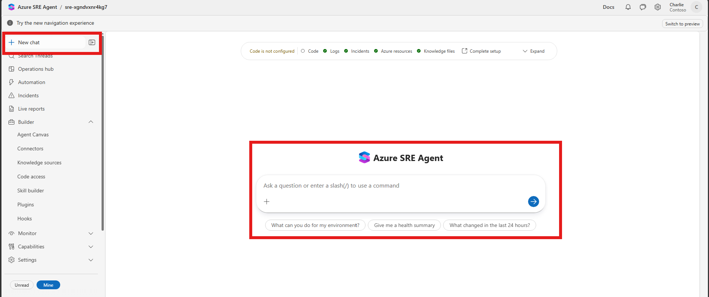

    ```text
    Compare today's high-CPU incident and the PostgreSQL connectivity incident on
    the Orders app. For each, give the start time, how it was detected, the
    cause, the customer impact, and the recovery. Use UTC with New Zealand time
    in parentheses. Do not make changes.
    ```

2. Check its times against the alert history and agent threads. Note any mismatch.
3. Now ask a follow-up about the SLO document:

    ```text
    Using our SLO and baselines document, what status would you give the Orders
    API, PostgreSQL, and VM right now? How do the current results compare with
    the documented baselines? Name the document you used.
    ```

    The baselines are fictitious demo values.

4. Use your notes to answer:
    1. Which found each fault sooner: the alert or the next scheduled run?
    2. What could the health check report that a single alert misses?
    3. Which agent or report claim needed your correction?
5. Keep the thread and report available for the final evidence capture. You will
   turn off the recurring task in Module 05.

## Check before moving on

* [ ] You saved and checked the scheduled-task configuration.
* [ ] You watched a run and checked its actual tool calls.
* [ ] You compared three claims with independent evidence.
* [ ] You generated the Live Report, approved only its read-only query tool, and
      checked its status.

## Quick check

??? question "Does a scheduled check replace the alert rules?"
    No. It runs only on its schedule. Alerts can detect a threshold breach
    much earlier; the scheduled check adds a broader review.

??? question "Why check a report that the agent saved successfully?"
    Saving proves it ran, not that its status or calculations are correct.
    Compare the output with the underlying records.

??? question "Which tool do you approve for the report?"
    Only the read-only workspace query tool. Decline anything that changes Azure
    resources, sends messages, or creates issues.

??? question "What can the agent do here that an alert cannot?"
    It reviews a whole period, charts it, compares incidents, and flags missing
    data. An alert only tells you that one threshold was crossed.

## Next

[Reset and preserve evidence :material-arrow-right:](../06-cleanup/index.md){ .md-button .md-button--primary }

<div class="sre-nav" markdown>
[:material-arrow-left: Module 03 - Respond to PostgreSQL Connectivity Loss](../04-incident-postgresql/index.md)
[Module 05 - Reset and Preserve Evidence :material-arrow-right:](../06-cleanup/index.md)
</div>
