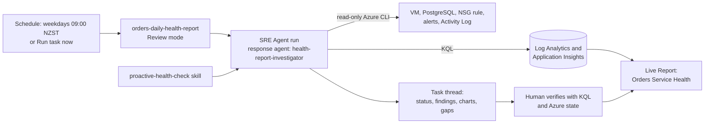

<ul class="sre-meta">
<li class="duration">Estimated time: 40 minutes</li>
<li>Module 05</li>
<li>Hands-on</li>
</ul>

## Overview

Modules 03 and 04 used the reactive path: a fault changed the workload, an Azure
Monitor alert fired, and the response plan started an investigation. This module
adds the proactive path. You install a scheduled task that asks the agent to
assess the workload every weekday morning by following a read-only skill, run it
on demand, verify what it reports, and build a Live Report that anyone with
access can refresh without starting another investigation.

The scenario introduces no fault. It assesses the healthy environment you
restored at the end of Module 04. If you completed Modules 03 and 04 within the
last 24 hours, the agent must also describe those two recovered incidents
correctly without reporting them as active.

Three pieces work together:

* A **skill** holds the procedure: what to measure, how to classify status, and
  how to report. In testing, the skill is what shaped every report.
* A **custom agent** holds instructions and a read-only tool list. The installer
  attaches no tool that changes Azure resources, sends email, or creates issues.
  Task 2 explains why you still check what a run actually used.
* A **scheduled task** holds the schedule and the prompt, names that custom agent
  as its response agent, and runs in Review mode.

A **Live Report** is separate. It is a saved, refreshable view that the agent
builds from your connected telemetry. Creating the report does not copy the task
output or change the schedule.

## Learning objectives

* Install a skill, a custom agent, and a scheduled task with a repeatable,
  read-back-verified command.
* Explain which controls bound a scheduled run, and why you verify the tools a
  run actually used instead of trusting its configuration.
* Run a scheduled task on demand and read its investigation thread.
* Verify the agent's health report against raw telemetry and Azure state.
* Build a read-only Live Report and refresh it.
* Compare proactive scheduled checks with alert-driven response.

## Proactive operating loop



The scheduled task is not an alert. An alert evaluates one condition every
minute and fires within minutes. A scheduled check runs at its interval, reads
many signals together, and explains them in context, so it can report slow
drift and quiet gaps that no single alert rule watches. It can also report a
problem hours after it began.

## Tasks

### Task 1: Confirm a healthy baseline and access

Load the generated values, restore both fault controls, and confirm that the
health check is not installed yet:

=== "Bash"

    ```bash
    source .workshop/workshop.env
    python scripts/workshop.py fault reset
    python scripts/workshop.py fault status
    python scripts/workshop.py smoke
    python scripts/workshop.py health-check status
    ```

=== "PowerShell"

    ```powershell
    . ./.workshop/workshop.ps1
    python scripts/workshop.py fault reset
    python scripts/workshop.py fault status
    python scripts/workshop.py smoke
    python scripts/workshop.py health-check status
    ```

Expect fault status to identify CPU and PostgreSQL as `inactive`,
`postgresqlAccess` as `Allow`, and `postgresqlConnectivity` as `ready`. Before
installation, `health-check status` reports `"installed": false` and lists the
three missing components in `problems`. That is a normal answer, not an error.

The check reports an area as Unknown when it has no samples in the last 15
minutes, so keep light traffic running while you work. Start it in another
terminal:

=== "Bash"

    ```bash
    source .workshop/workshop.env
    ./scripts/generate-load.sh "${SERVICE_ORDERS_API_ENDPOINT_URL}" 1 1800
    ```

=== "PowerShell"

    ```powershell
    . ./.workshop/workshop.ps1
    $until = (Get-Date).AddMinutes(30)
    $products = 'SKU-1001','SKU-1002','SKU-1003','SKU-1004','SKU-1005'
    while ((Get-Date) -lt $until) {
      $body = @{
        customerId = "health-$((Get-Random -Maximum 500))"
        productId  = $products | Get-Random
        quantity   = Get-Random -Minimum 1 -Maximum 6
      } | ConvertTo-Json
      Invoke-RestMethod `
        -Method Post `
        -Uri "$env:SERVICE_ORDERS_API_ENDPOINT_URL/orders" `
        -ContentType 'application/json' `
        -Body $body | Out-Null
      Start-Sleep -Seconds 1
    }
    ```

In the Azure SRE Agent portal, confirm that the **Application Insights** and
**Log Analytics** connectors report a healthy state under **Build + setup** >
**Extensions** > **Connectors**. The installer refuses to continue when the
`log-analytics` connector is not healthy. Installing a task and creating a Live
Report also need read and write permission on the agent. The agent-scoped
administrator role you received for Module 02 provides it. Portal labels can
differ slightly between portal versions.

Record the start time in UTC and in New Zealand time:

=== "Bash"

    ```bash
    mkdir -p .workshop/notes
    printf '# Scheduled health check\n\nStarted at UTC: %s\n\n' \
      "$(date -u +%Y-%m-%dT%H:%M:%SZ)" > .workshop/notes/scheduled-health-check.md
    cat .workshop/notes/scheduled-health-check.md
    ```

=== "PowerShell"

    ```powershell
    New-Item -ItemType Directory -Force .workshop/notes | Out-Null
    $started = (Get-Date).ToUniversalTime().ToString('yyyy-MM-ddTHH:mm:ssZ')
    "# Scheduled health check`n`nStarted at UTC: $started`n" |
      Set-Content .workshop/notes/scheduled-health-check.md
    Get-Content .workshop/notes/scheduled-health-check.md
    ```

### Task 2: Review what you will install

Open these two files in your editor before you install anything:

| Component | Name | Defined in |
| --- | --- | --- |
| Skill | `proactive-health-check` | `agent/skills/proactive-health-check/SKILL.md` |
| Custom agent | `health-report-investigator` | `agent/scheduled-tasks/orders-daily-health-report.yaml` |
| Scheduled task | `orders-daily-health-report` | `agent/scheduled-tasks/orders-daily-health-report.yaml` |

The skill names the exact tables, operations, alert rules, and the NSG rule from
your deployment. It defines how to classify each area as Healthy, Degraded,
Unhealthy, or Unknown, and it states that missing samples are never successes.
The installer configures only these tools on the custom agent:

| Tool | Attached | Reason |
| --- | --- | --- |
| `QueryLogAnalyticsByWorkspaceId` | Yes, added from the healthy `log-analytics` connector | Read the `App*`, `Heartbeat`, and `Perf` tables |
| `QueryAppInsightsUsingAppId` | Yes, added from the healthy `app-insights` connector | Cross-check request and dependency data |
| `GetAzCliHelp`, `RunAzCliReadCommands` | Yes | Read VM, PostgreSQL, NSG rule, alert, and Activity Log state |
| `PlotAreaChartWithCorrelation`, `PlotBarChart` | Yes | Chart trends and comparisons |
| `RunAzCliWriteCommands` | No | The task has no Azure write tool |
| `SendOutlookEmail`, `CreateGithubIssue` | No | This workshop makes no external writes |

The task runs in **Review** mode. Review mode is the same safety model as the
response plan from Module 02, applied to a schedule. The installer checks these
properties before it writes anything and refuses a definition that attaches a
tool outside the read-only set. It also pins the agent's optional tool
categories (MCP tools, connectors, other agents, and common tools) to empty and
disables added system skills.

!!! warning "A scheduled run does not necessarily use the custom agent's tool list"
    When this module was tested against a live agent, scheduled runs did not
    apply the custom agent's instructions or tool list. A diagnostic run that
    asked the agent to name itself and its tools answered as the main Azure SRE
    Agent and listed the platform's default tools: file, terminal, to-do, memory
    and incident-knowledge search, `GetAzCliHelp`, `RunAzCliReadCommands`, the
    two chart tools, and `QueryLogAnalyticsByWorkspaceId`. There was no Azure
    write tool. `QueryAppInsightsUsingAppId` was not available, even though the
    custom agent lists it, so the report says that the Application Insights
    cross-check was unavailable and relies on the workspace tables, which hold
    the same data.

    Treat the custom agent's tool list as configuration that the installer
    verifies, not as the safety boundary of a scheduled run. The boundaries that
    applied were Review mode, the agent's Reader role (access level Low), and the
    read-only rules in the skill and the task prompt, which is why those rules
    live there. Preview behavior can change, so confirm it in your own thread in
    Task 4.

!!! note "Time zones in this module"
    The SRE Agent evaluates the schedule in UTC and has no time-zone setting.
    The task uses the cron expression `0 21 * * 0-4`, which is Sunday to
    Thursday at 21:00 UTC, so it runs Monday to Friday at 09:00 New Zealand
    Standard Time (NZST, UTC+12). While New Zealand observes daylight time
    (NZDT, UTC+13, late September to early April) it runs at 10:00 local time.
    For 09:00 NZDT, change `schedule` in the YAML file to `0 20 * * 0-4` and run
    `health-check install` again.

    Reports show New Zealand time beside UTC, computed in each query with
    `datetime_utc_to_local(TimeGenerated, 'Pacific/Auckland')`. Azure telemetry,
    the Activity Log, alerts, and your notes from Modules 01 to 04 use UTC, so
    UTC remains the reference when you correlate evidence.

### Task 3: Install and verify the health check

=== "Bash"

    ```bash
    python scripts/workshop.py health-check install
    python scripts/workshop.py health-check status
    ```

=== "PowerShell"

    ```powershell
    python scripts/workshop.py health-check install
    python scripts/workshop.py health-check status
    ```

The command writes the skill, then the custom agent, then the scheduled task. It
then reads all three back and succeeds only when the schedule, the Review mode,
the enabled state, the handling agent, the attached tools, the empty optional
tool categories, and the instruction, prompt, and skill text match the
definition. Repeating it is safe because it rewrites the same three items. It
does not change the response plan, the connectors, or any Azure resource. A 403
or 404 in the first minutes after provisioning is retried.

A successful result has this shape. Timestamps and ordering of the tool list can
differ:

```json
{
  "ok": true,
  "installed": true,
  "matchesDefinition": true,
  "scheduledTask": {
    "name": "orders-daily-health-report",
    "cronExpression": "0 21 * * 0-4",
    "agent": "health-report-investigator",
    "agentMode": "Review",
    "enabled": true
  },
  "customAgent": {
    "name": "health-report-investigator",
    "tools": [
      "GetAzCliHelp",
      "PlotAreaChartWithCorrelation",
      "PlotBarChart",
      "QueryAppInsightsUsingAppId",
      "QueryLogAnalyticsByWorkspaceId",
      "RunAzCliReadCommands"
    ]
  },
  "skills": { "proactive-health-check": true },
  "problems": [],
  "checkedUtc": "2026-10-12T00:00:00+00:00"
}
```

`health-check status` reads the same state without writing anything. If someone
edits the task, the custom agent, or the skill in the portal, including its
instructions, prompt, or skill text, `matchesDefinition` becomes `false` and
`problems` names the difference. The read-back evidence is saved in
`.workshop/<environment>/scheduled-health-check.json`.

In the Azure SRE Agent portal, confirm the result independently:

1. Open **Scheduled tasks** and find `orders-daily-health-report`. Its status
   should be **On**, its response custom agent should be
   `health-report-investigator`, and its autonomy level should be **Review**.
2. Note the schedule and the next run time the portal displays.
3. Open the custom agent and confirm that it lists the six tools from Task 2 and
   the `proactive-health-check` skill, and no write tool.

<!-- SCREENSHOT: Scheduled tasks list showing orders-daily-health-report on, in Review mode, with its next run -->

!!! warning "The recurring schedule uses agent units"
    Each scheduled run, and each creation or update of a Live Report, consumes
    Azure Agent Units. The agent has a 500 unit monthly limit. Module 06 removes
    the task before deletion. See
    [Cost Management](../30-appendix/03-cost-management.md) for the details.

### Task 4: Run the task now and read the thread

Keep the traffic from Task 1 running. In the portal, open
`orders-daily-health-report` and select **Run task now**. Leave the recurring
schedule on. The run creates a conversation thread titled `Scheduled Task:
orders-daily-health-report`. It can take several minutes (about three in
testing) because the agent plans, queries, charts, and writes the report.

Read the thread against this checklist:

* The window start and end in UTC with New Zealand time, and the Log Analytics
  workspace and Application Insights resource it queried.
* An overall status and a separate current status for the customer path, the
  PostgreSQL dependency, and the VM.
* Request volume, success rate, and P95 duration for each operation, with
  `GET /health/live` kept separate from the database-backed operations.
* A baseline statement. A new environment has less than seven days of data, so
  the agent must say that no baseline exists instead of inventing one.
* Window findings: for each breach in the 24 hours, its start, end, whether it
  is active or resolved, and the Activity Log events near its start.
* Charts labeled with the UTC window, New Zealand time, units, and series.
* Missing or sparse evidence recorded as gaps.
* Recommendations phrased for a human operator, and a closing statement that no
  resource, email, issue, memory, or Live Report was changed or created.
* Every tool call card that reads your environment is a read: a Log Analytics
  query, a read-only Azure CLI command such as `list`, `show`, or an Activity Log
  query, or a chart. Planning to-do updates are fine. Nothing creates, updates,
  deletes, restarts, or sends.

The report may state that the Application Insights cross-check was unavailable
and that it used the Log Analytics workspace instead. That is expected. See the
warning in Task 2.

If you completed Modules 03 and 04 within the last 24 hours, expect resolved
findings for the CPU saturation and the PostgreSQL connectivity loss, with the
Run Command and security rule writes from those modules as nearby Activity Log
events, while the current state is Healthy. A resolved breach must not change
the current status.

If the customer path is reported as Unknown, your traffic stopped or telemetry
has not been ingested yet. Restart the traffic, wait a few minutes, and run the
task again. Unknown is the correct answer when there are no recent samples.

The installer attaches no tool that changes Azure resources. Decline any
approval prompt that proposes a change.

<!-- SCREENSHOT: Health check task thread with overall status, per-area table, and 24-hour charts -->

Record the run time, the overall status, and the claims you want to verify in
`.workshop/notes/scheduled-health-check.md`.

### Task 5: Verify the report independently

A well-formatted report is not evidence. Check the main claims against raw
telemetry for the same window. Request outcomes by operation:

=== "Bash"

    ```bash
    az monitor log-analytics query \
      --workspace "${LOG_ANALYTICS_CUSTOMER_ID}" \
      --analytics-query "
    AppRequests
    | where TimeGenerated > ago(24h)
    | where AppRoleName == 'orders-api'
    | extend Samples = tolong(coalesce(ItemCount, 1))
    | summarize
        Requests = sum(Samples),
        Failed = sumif(Samples, Success == false),
        P95Ms = round(percentile(DurationMs, 95), 1),
        LastUtc = max(TimeGenerated)
      by Name
    | extend SuccessRate = round(100.0 * todouble(Requests - Failed) / todouble(Requests), 2)
    | extend LastNz = datetime_utc_to_local(LastUtc, 'Pacific/Auckland')
    | order by Name asc
    " \
      --output table
    ```

=== "PowerShell"

    ```powershell
    $query = @'
    AppRequests
    | where TimeGenerated > ago(24h)
    | where AppRoleName == 'orders-api'
    | extend Samples = tolong(coalesce(ItemCount, 1))
    | summarize
        Requests = sum(Samples),
        Failed = sumif(Samples, Success == false),
        P95Ms = round(percentile(DurationMs, 95), 1),
        LastUtc = max(TimeGenerated)
      by Name
    | extend SuccessRate = round(100.0 * todouble(Requests - Failed) / todouble(Requests), 2)
    | extend LastNz = datetime_utc_to_local(LastUtc, 'Pacific/Auckland')
    | order by Name asc
    '@

    az monitor log-analytics query `
      --workspace $env:LOG_ANALYTICS_CUSTOMER_ID `
      --analytics-query $query `
      --output table
    ```

PostgreSQL dependency bins that contain failures, plus the last hour:

=== "Bash"

    ```bash
    az monitor log-analytics query \
      --workspace "${LOG_ANALYTICS_CUSTOMER_ID}" \
      --analytics-query "
    AppDependencies
    | where TimeGenerated > ago(24h)
    | where AppRoleName == 'orders-api' and DependencyType == 'PostgreSQL'
    | extend Samples = tolong(coalesce(ItemCount, 1))
    | summarize
        Calls = sum(Samples),
        Failed = sumif(Samples, Success == false),
        P95Ms = round(percentile(DurationMs, 95), 1)
      by TimeGenerated = bin(TimeGenerated, 15m)
    | where Failed > 0 or TimeGenerated > ago(1h)
    | extend FailurePercent = round(100.0 * todouble(Failed) / todouble(Calls), 2)
    | extend NzTime = datetime_utc_to_local(TimeGenerated, 'Pacific/Auckland')
    | order by TimeGenerated asc
    " \
      --output table
    ```

=== "PowerShell"

    ```powershell
    $query = @'
    AppDependencies
    | where TimeGenerated > ago(24h)
    | where AppRoleName == 'orders-api' and DependencyType == 'PostgreSQL'
    | extend Samples = tolong(coalesce(ItemCount, 1))
    | summarize
        Calls = sum(Samples),
        Failed = sumif(Samples, Success == false),
        P95Ms = round(percentile(DurationMs, 95), 1)
      by TimeGenerated = bin(TimeGenerated, 15m)
    | where Failed > 0 or TimeGenerated > ago(1h)
    | extend FailurePercent = round(100.0 * todouble(Failed) / todouble(Calls), 2)
    | extend NzTime = datetime_utc_to_local(TimeGenerated, 'Pacific/Auckland')
    | order by TimeGenerated asc
    '@

    az monitor log-analytics query `
      --workspace $env:LOG_ANALYTICS_CUSTOMER_ID `
      --analytics-query $query `
      --output table
    ```

VM heartbeats per hour (about 60 when continuous) and the peak guest CPU:

=== "Bash"

    ```bash
    az monitor log-analytics query \
      --workspace "${LOG_ANALYTICS_CUSTOMER_ID}" \
      --analytics-query "
    let vmId = '${VM_RESOURCE_ID}';
    union isfuzzy=true
      (Heartbeat
       | where TimeGenerated > ago(24h) and _ResourceId =~ vmId
       | summarize Value = todouble(count()) by TimeGenerated = bin(TimeGenerated, 1h)
       | extend Signal = 'HeartbeatsPerHour'),
      (Perf
       | where TimeGenerated > ago(24h) and _ResourceId =~ vmId
       | where CounterName == '% Processor Time' and InstanceName == '_Total'
       | summarize Value = round(max(CounterValue), 1) by TimeGenerated = bin(TimeGenerated, 1h)
       | extend Signal = 'MaxGuestCpuPercent')
    | extend NzTime = datetime_utc_to_local(TimeGenerated, 'Pacific/Auckland')
    | order by Signal asc, TimeGenerated asc
    " \
      --output table
    ```

=== "PowerShell"

    ```powershell
    $query = @"
    let vmId = '$env:VM_RESOURCE_ID';
    union isfuzzy=true
      (Heartbeat
       | where TimeGenerated > ago(24h) and _ResourceId =~ vmId
       | summarize Value = todouble(count()) by TimeGenerated = bin(TimeGenerated, 1h)
       | extend Signal = 'HeartbeatsPerHour'),
      (Perf
       | where TimeGenerated > ago(24h) and _ResourceId =~ vmId
       | where CounterName == '% Processor Time' and InstanceName == '_Total'
       | summarize Value = round(max(CounterValue), 1) by TimeGenerated = bin(TimeGenerated, 1h)
       | extend Signal = 'MaxGuestCpuPercent')
    | extend NzTime = datetime_utc_to_local(TimeGenerated, 'Pacific/Auckland')
    | order by Signal asc, TimeGenerated asc
    "@

    az monitor log-analytics query `
      --workspace $env:LOG_ANALYTICS_CUSTOMER_ID `
      --analytics-query $query `
      --output table
    ```

The Azure state the agent reads with its read-only tools:

=== "Bash"

    ```bash
    az network nsg rule show \
      --resource-group "${RESOURCE_GROUP}" \
      --nsg-name "${NETWORK_SECURITY_GROUP_NAME}" \
      --name "${POSTGRESQL_FAULT_RULE_NAME}" \
      --query "{Name:name,Access:access}" \
      --output table

    az postgres flexible-server show \
      --resource-group "${RESOURCE_GROUP}" \
      --name "${POSTGRESQL_SERVER_NAME}" \
      --query "{Name:name,State:state,PublicAccess:network.publicNetworkAccess}" \
      --output table

    az vm get-instance-view \
      --ids "${VM_RESOURCE_ID}" \
      --query "instanceView.statuses[?starts_with(code, 'PowerState/')].displayStatus" \
      --output tsv
    ```

=== "PowerShell"

    ```powershell
    az network nsg rule show `
      --resource-group $env:RESOURCE_GROUP `
      --nsg-name $env:NETWORK_SECURITY_GROUP_NAME `
      --name $env:POSTGRESQL_FAULT_RULE_NAME `
      --query "{Name:name,Access:access}" `
      --output table

    az postgres flexible-server show `
      --resource-group $env:RESOURCE_GROUP `
      --name $env:POSTGRESQL_SERVER_NAME `
      --query "{Name:name,State:state,PublicAccess:network.publicNetworkAccess}" `
      --output table

    az vm get-instance-view `
      --ids $env:VM_RESOURCE_ID `
      --query "instanceView.statuses[?starts_with(code, 'PowerState/')].displayStatus" `
      --output tsv
    ```

Expect the NSG rule access to be `Allow`, the server state to be `Ready` with
public access `Disabled`, and the VM to report `VM running`.

Now grade the thread. List its five most important claims, for example the
overall status, the request success rate, the PostgreSQL failure count, the peak
CPU, and the NSG rule state. For each, record whether your queries show it as
Supported, Partly supported, or Unsupported. Small numeric differences are
expected because the agent's window ended when its run started and your queries
ran later. Judge the evidence, not whether the digits match.

Then challenge one claim in the thread:

```text
For the PostgreSQL dependency, list each 15-minute bin with failures in the
window. Give the query you ran, its row count, and the first and last failure
time in UTC and New Zealand time. If there were none, say so and state how many
samples you saw.
```

A correct answer shows its query and row count and distinguishes no failures
from no data.

### Task 6: Create the Live Report

The task thread is a point-in-time analysis. A Live Report is a saved view you
can reload at any time.

!!! info "Before you start"
    * **Agent role.** Creating a report, and running its queries when you open
      or reload it, needs the SRE Agent Standard User, SRE Agent Author, or SRE
      Agent Administrator role. Approving the report's tool needs SRE Agent
      Administrator, which `azd up` gives to the person who deployed the agent.
      If an instructor deployed a shared agent, ask them to assign the role at
      the agent scope.
    * **Who runs the queries.** The portal states that a report's tools run as
      the agent. The Log Analytics Reader role that `azd up` assigns to the
      agent is what lets the report read the workspace. You do not need your
      own.
    * **Recent telemetry.** Keep the traffic from Task 1 running. An area with
      no samples in the last 15 minutes is reported as No data.
    * **Timing.** Role assignments can take several minutes to propagate after
      `azd up`. If the agent reports a 403 on its first test queries, wait and
      ask it to retry. See the troubleshooting appendix.

In the portal:

1. Select **Live Reports** in the navigation, then **+ New report**. The agent
   starts an authoring thread, explains what a Live Report is, names the
   connector it will use (in testing, the Azure Monitor connector
   `system-mcp-monitor`), and typically asks what the report should focus on.
2. Answer with this request. Use the free-text box rather than one of the
   suggested options:

    ```text
    Build a Live Report called "Orders Service Health" from the agent's
    connected Log Analytics workspace and Application Insights data. Cover the
    last 24 hours with a time-range selector. Show New Zealand time
    (Pacific/Auckland) computed with datetime_utc_to_local as plain text such as
    2026-10-13 10:47, without a UTC offset suffix. Label the zone and keep UTC
    available in a tooltip or secondary column.

    Include:
    1. Orders API request volume, success rate, and P95 duration by operation
       from AppRequests where AppRoleName is "orders-api". Show GET /health/live
       separately from the database-backed operations.
    2. PostgreSQL dependency calls, failure percentage, and P95 duration from
       AppDependencies where DependencyType is "PostgreSQL".
    3. Database availability results from AppAvailabilityResults where Name is
       "orders-api-postgresql".
    4. VM heartbeat continuity from Heartbeat and guest CPU from Perf where
       CounterName is "% Processor Time".
    5. A status indicator for each area, computed only from the last 15 minutes
       and independent of the selected window:
       - No data: no samples in the last 15 minutes. Never show Healthy
         without samples.
       - Unhealthy: any failed request, PostgreSQL dependency call, or
         availability check; average guest CPU above 80 percent; or a
         heartbeat gap longer than 5 minutes.
       - Degraded: no failures, but P95 duration above 1,000 ms.
       - Healthy: samples exist and none of the above applies.
       Show the selected-window numbers beside each status. A failure earlier
       in the window that has recovered is a window finding, not the current
       status.
    6. A short list of missing data.

    Use read-only queries only. Do not add model-assisted analysis, buttons, or
    any tool that changes Azure resources, sends email, or creates issues.
    ```

3. Answer any further questions from the agent. It lists the workspace, runs a
   test query for each table, builds the report, and asks for one approval. In
   testing, the approval said the report "can call 1 connector tool each time
   it's opened" and named `system-mcp-monitor`, the tool that queries logs
   across a Log Analytics workspace with KQL. Approve a read-only query tool
   like this one. Reject any approval that writes, sends, or creates. A saved
   report can call only the tools you approve for it.
4. Wait for the report to save, which took three to four minutes in testing.
   The thread shows "Live report created" with a version number. Open the
   report from **Live Reports**.

Do not trust a report because it saved. The agent writes the report's code from
your request, so each generation differs in layout and can contain mistakes. In
testing, one version showed PostgreSQL as No data while its own table listed
more than 1,200 calls, because its status code read the wrong count column.
Check the report against your own evidence:

* Each status matches its table and the last 15 minutes of your Task 5 queries.
  With traffic running, the API, PostgreSQL, and database availability areas are
  Healthy. Failures from Modules 03 and 04 appear in the 24-hour numbers but do
  not make the current status Unhealthy after they recover.
* VM heartbeat and guest CPU show samples when the Azure Monitor Agent is
  reporting. If they show No data, run the Task 5 `Heartbeat` and `Perf` queries
  before you blame the report.
* New Zealand times are plain text such as `2026-10-13 10:47` with the zone
  labeled and UTC beside them. A `+00:00` suffix on a New Zealand time is a
  defect.
* A No data status has an empty table or an entry in the missing-data list. A No
  data status above a table that shows samples is a defect.

Select **Reload** to bypass cached results and request current data. To fix a
defect, select **Open authoring thread**, describe it, and let the agent re-test
and save a new version. Each version keeps the layout, not the historical data.
Create the report once. Asking for it again from **+ New report** creates a
second report with the same name, and deleting a report needs SRE Agent
Administrator.

<!-- SCREENSHOT: Orders Service Health Live Report with status cards and 24-hour tables -->

The task and the report differ in cost and in purpose:

* Creating or updating a report consumes agent units. Reloading a report that
  only retrieves data through connector tools does not. A section that asks a
  model to summarize the data consumes units on every refresh, which is why the
  prompt excludes model-assisted analysis.
* A task run consumes agent units every time, but it explains the data, compares
  it with a baseline, and records its reasoning in a thread.

If the report cannot read a table through the connected tools, ask the agent in
the authoring thread to list the data sources it can use, adjust the report, and
record the limitation in your notes. Live Reports is a preview feature. In
testing it worked on the workshop's default deployment (Stable upgrade channel,
Australia East) with no extra setting. If it is not available for your agent,
record that in your notes, skip to Task 7, and keep the Task 5 queries as your
operational view.

### Task 7: Compare proactive and reactive detection

Open your notes from Modules 03 and 04 (`incident-01-cpu.md` and
`incident-02-postgresql.md`) and answer these questions in
`.workshop/notes/scheduled-health-check.md`:

1. For each incident, how long after the fault request would the next scheduled
   run have reported it? Use the schedule from Task 2, remembering that the task
   runs on weekdays only.
2. Which condition in the health check could the three alert rules miss? Consider
   a gradual rise in P95 duration, or a short gap in heartbeats.
3. Which condition would an alert catch much earlier than the schedule?

Use your own times in UTC and New Zealand time rather than estimates.

### Task 8: Record your results

Append the outcome to your notes:

=== "Bash"

    ```bash
    cat >> .workshop/notes/scheduled-health-check.md <<'EOF'
    ## Result

    Task run (UTC and New Zealand time):
    Overall status reported:
    Claims graded (supported, partly supported, unsupported):
    Live Report created (yes or no):
    Baseline, gaps, and follow-up:
    EOF
    ```

=== "PowerShell"

    ```powershell
    @'
    ## Result

    Task run (UTC and New Zealand time):
    Overall status reported:
    Claims graded (supported, partly supported, unsupported):
    Live Report created (yes or no):
    Baseline, gaps, and follow-up:
    '@ | Add-Content .workshop/notes/scheduled-health-check.md
    ```

Fill in each line. Leave the scheduled task enabled for now. Stop the traffic
from Task 1 with ++ctrl+c++ when you finish. Module 06 downloads a snapshot of
the Live Report and removes the task before it deletes the environment.

## Validation

* [x] The environment was reset to CPU inactive and PostgreSQL `Allow` before the
  first run.
* [x] `health-check install` read back the skill, custom agent, and scheduled
  task, and `health-check status` reported `matchesDefinition` as `true`.
* [x] The installer configured only read-only tools, every tool call card that
  reads your environment was a read, and the task runs in Review mode.
* [x] The task thread reports UTC with New Zealand time, a current status for each
  area, window findings, and a baseline statement.
* [x] You graded the main claims against KQL results and Azure resource state.
* [x] You built the Live Report, checked each status against its table and your
  Task 5 queries, fixed any defect in a new version, and reloaded it, or you
  recorded why you skipped it.
* [x] You compared scheduled and alert-driven detection using your own incident
  times.

## Knowledge check

??? question "Why does the report say Unknown instead of Healthy when an area has no recent samples?"
    Absence of data is not evidence of success. Telemetry can be missing because traffic stopped, the agent stopped sending it, or ingestion is delayed. Reporting Unknown keeps the gap visible. The same rule applies to the Module 04 dependency baseline, where missing samples are not the same as successful samples.

??? question "Why is a weekday scheduled check not a replacement for the alert rules?"
    The check can report a problem only at its next run, which can be many hours or a weekend later. Alert rules evaluate every minute and trigger the response plan within minutes. The schedule adds context and finds slow drift or quiet gaps that no single alert rule watches. The two paths cover different failure shapes.

??? question "Which controls limited what the scheduled run could do?"
    A scheduled run has no human watching it start, so its authority should be small and checked. Review mode, the agent's Reader role, and the read-only rules in the skill and the task prompt bounded the run. The installer also configures only read-only tools on the custom agent. In testing, the run did not apply that tool list and used the platform's default tools, so configuration alone is not proof. Reading every tool call in the thread is.

??? question "Why does reloading a Live Report usually cost less than running the task again?"
    A reload that only retrieves data through connector tools does not consume active-flow agent units. A task run asks the model to plan, query, reason, and write each time. A report section that asks a model to summarize the data loses the saving because it runs on every refresh.

??? question "Why must you check a Live Report after the agent saves it?"
    Saving proves only that the generated code ran. The agent writes the report from your request, so its layout and status logic differ on every generation. In testing, a saved version showed No data for an area that had samples. Compare each status with its table and your own queries, and fix defects in the authoring thread, which saves a new version.

## Next steps

[Next: Module 06 - Preserve Evidence and Clean Up :material-arrow-right:](../06-cleanup/index.md){ .md-button .md-button--primary }

<div class="sre-nav" markdown>
[:material-arrow-left: Module 04 - Respond to PostgreSQL Connectivity Loss](../04-incident-postgresql/index.md)
[Module 06 - Preserve Evidence and Clean Up :material-arrow-right:](../06-cleanup/index.md)
</div>
