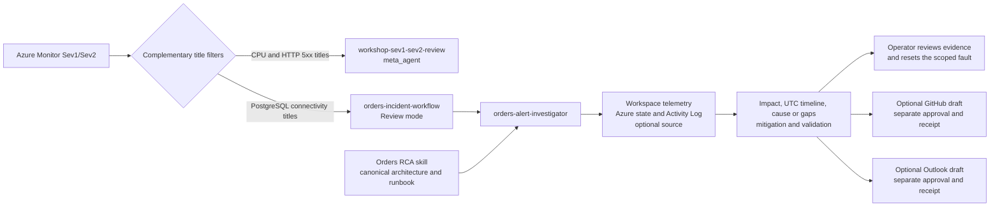

<ul class="sre-meta">
<li>Optional module after Module 04</li>
<li>Advanced workflow</li>
<li>Hands-on</li>
</ul>

## Overview

Module 04 taught you to diagnose a PostgreSQL connectivity failure. This module
uses the same fault to teach a different lesson: package the investigation as a
reusable skill, route the alert to a dedicated investigator, and review
evidence-backed incident follow-ups.

It adapts [Scenario 1 of Microsoft's SRE Agent onboarding lab](https://github.com/microsoft/sre-agent/blob/25a42306d298c4d28f11dd11ef9bb93cb0393be8/labs/onboardinglab/README.md#scenario-1-incident-workflow)
to this workshop's .NET Orders API VM and private PostgreSQL server. It does not
deploy the upstream App Service or ticketing application.

You install `orders-incident-workflow` and `orders-alert-investigator`. Both the
new response plan and `workshop-sev1-sev2-review` stay enabled for Sev1 and Sev2
in Review mode. Complementary title filters keep one alert from matching both
plans: PostgreSQL-connectivity titles use the new investigator, while CPU and
the customer-impact HTTP 5xx alert continue through the original plan.

The agent investigates without changing the workload. You inject the fault and
run the reset. GitHub issue creation and Outlook email are separate optional
writes, each requiring an explicit request and approval for its exact
destination and content.

## Learning objectives

* Explain the roles of a skill, custom agent, and response plan.
* Keep two active response plans mutually exclusive by title.
* Verify a dedicated investigator's actual execution and evidence.
* Separate process liveness, dependency readiness, and customer impact.
* Review optional issue and email drafts without granting workload write access.
* Reconcile action receipts instead of blindly repeating uncertain writes.
* Restore the original routing without changing the scheduled health check.

## Workflow



The installer discovers the PostgreSQL ARM rule name and deployed display name. The log
alert `alert-orders-postgresql-connectivity`, for example, has the display name
`Orders PostgreSQL dependency failures`. Do not assume an incident title uses
only the ARM name.

The new plan uses scalar `titleContains: postgresql`. The original uses
`titleContains: alert-orders-h`, which matches `alert-orders-high-cpu` and
`alert-orders-http-5xx`, but not the PostgreSQL rule. The installer preserves the
original snapshot and restores it on removal. Installing only the new positive
filter would leave the original catch-all overlapping.

!!! warning "Read-back is not dispatch proof"
    In live verification, the Stable preview retained `titleContainsAny` and
    `titleNotContains` arrays but sent a CPU alert to the PostgreSQL investigator.
    A workspace target-resource guard was also retained without preventing that
    dispatch. This module therefore uses two disjoint scalar title filters, not
    those advanced fields. Both plans still accept Sev1 and Sev2. Confirm actual
    dispatch in your own threads; do not infer it from stored configuration.

## Tasks

### Task 1: Establish the baseline and configuration access

Complete Modules 01 through 04 and resolve their alerts before continuing.
Use the same selected azd environment:

=== "Bash"

    ```bash
    source .workshop/workshop.env
    python scripts/workshop.py fault reset
    python scripts/workshop.py fault status
    python scripts/workshop.py smoke
    python scripts/workshop.py incident-workflow status
    ```

=== "PowerShell"

    ```powershell
    . ./.workshop/workshop.ps1
    python scripts/workshop.py fault reset
    python scripts/workshop.py fault status
    python scripts/workshop.py smoke
    python scripts/workshop.py incident-workflow status
    ```

Before installation, expect `installed: false`, `phase: absent`, and an empty
`unownedComponents` list. The `problems` entry stating that the optional workflow
is not installed is normal. Orphaned components are not normal; do not overwrite
them.

Confirm healthy customer requests, CPU and PostgreSQL faults inactive, the
scoped NSG rule at `Allow`, and a healthy `log-analytics` connector. The agent
must still use **Low** access, **Review** mode, and Azure Monitor, with this
workshop group as its only managed resource group. The title partition
must not divert identically named alerts from another environment on a shared
agent.

You need **SRE Agent Administrator** on the agent to install the workflow.
Module 02 gives this role to the deployment identity, not automatically to
every participant. SRE Agent Standard User does not provide configuration
authority. Do not grant the runtime identity Contributor or Owner.

Keep a witness order ID from Module 04, or create a synthetic order in the
Orders GUI and record its real ID. Verify that you can retrieve it before the
outage. Never substitute the example ID from another environment.

### Task 2: Review the definitions and choose optional connections

Inspect these repository files:

| Component | Definition |
| --- | --- |
| Investigator and incident trigger | `agent/workflows/orders-incident-workflow.yaml` |
| RCA procedure | `agent/skills/orders-azure-monitor-rca/SKILL.md` |
| GitHub follow-up | `agent/skills/orders-github-issue-followup/SKILL.md` |
| Email follow-up | `agent/skills/orders-email-incident-followup/SKILL.md` |

The installer appends the canonical architecture, investigation principles,
and PostgreSQL dependency runbook to the RCA skill. It does not reactivate the
legacy agent configuration files or create another knowledge-upload pipeline.

The base investigator receives the workspace query tool, read-only Azure CLI
tools, and chart tools. Application Insights querying is an optional
cross-check. Terminal, Azure writes, VM Run Command, and fault execution are
not attached.

You can complete the core exercise without source, GitHub, or Outlook access.
To include them, use the SRE Agent portal before installing:

* For source evidence, connect the exact workshop repository through **Build +
  setup** > **Context** > **Code access**, complete GitHub OAuth, and check its
  branch/commit. A configured repository is not proof that its source matches
  the deployed application.
* For an issue, choose your own training repository, enable Issues, and connect
  that exact repository through Code Access as well. The source repository and
  incident repository can differ. Do not publish to Microsoft's repository or
  the workshop maintainer's repository by default.
* For email, connect **Office 365 Outlook** under **Extensions** >
  **Connectors**, complete OAuth, and confirm the sending account and
  `Connected` state. Use the actual connection/server name, usually
  `office365`, not only its display label.
* Under **Tools** > **Advanced Permissions**, require **Ask** for
  `CreateGithubIssue` and `SendOutlookEmail`. Preserve existing policies. The
  installer does not replace them and will not attach a write tool when a
  matching Allow or Deny override makes the selected policy unsuitable.

The exact `Ask` entries are checked through the agent API. A YAML
`ask_approval` group is a declaration, not proof of enforcement. If the native
tool or approval interaction is unavailable in your preview, keep the follow-up
draft-only.

!!! warning "Connections and global policies are agent-wide"
    The new investigator has its own explicit tool list. The Module 05
    health-check custom agent remains unchanged and must not send email or
    create issues. Scheduled preview runs have ignored custom tool lists, so
    preserve the health-check skill and task prompt rules and verify what a
    scheduled run actually uses after connecting optional services.

### Task 3: Install and inspect both response plans

For the core exercise:

```bash
python scripts/workshop.py incident-workflow install
python scripts/workshop.py incident-workflow status
```

Alternatively, install with the optional capabilities you configured. Replace
every placeholder and use only approved test destinations:

=== "Bash"

    ```bash
    python scripts/workshop.py incident-workflow install \
      --source-repository "https://github.com/YOUR-USER/YOUR-WORKSHOP-REPO" \
      --github-repository "https://github.com/YOUR-USER/YOUR-INCIDENT-REPO" \
      --outlook-connector office365 \
      --email-to "YOUR-APPROVED-TEST-ADDRESS"
    python scripts/workshop.py incident-workflow status
    ```

=== "PowerShell"

    ```powershell
    python scripts/workshop.py incident-workflow install `
      --source-repository "https://github.com/YOUR-USER/YOUR-WORKSHOP-REPO" `
      --github-repository "https://github.com/YOUR-USER/YOUR-INCIDENT-REPO" `
      --outlook-connector office365 `
      --email-to "YOUR-APPROVED-TEST-ADDRESS"
    python scripts/workshop.py incident-workflow status
    ```

Omit flags for capabilities you do not want. `--email-to` can be repeated for
approved To recipients; the workflow supports no CC, BCC, or attachments.
Specifying a destination enables consideration of the capability, not
permission to publish.

The installer checks the agent, connectors, deployed alerts, competing plans,
and trusted resource bindings before writing. It saves the original response
plan, writes skills and the investigator, stages the new plan disabled, verifies
the original plan's scalar title filter, and only then enables the new plan.

Expect this core result:

```json
{
  "ok": true,
  "installed": true,
  "matchesDefinition": true,
  "phase": "active",
  "responsePlan": "orders-incident-workflow",
  "handlingAgent": "orders-alert-investigator",
  "problems": []
}
```

The full output includes the discovered title lists, components, and separate
`source`, `github`, and `email` capability results under `followups`. An
unavailable optional connection has `enabled: false` and an explicit reason;
the core RCA can still run.

Inspect the result independently in **Response plans** or **Workflows**:

| Setting | Original plan | New plan |
| --- | --- | --- |
| Name | `workshop-sev1-sev2-review` | `orders-incident-workflow` |
| Enabled | Yes | Yes |
| Platform and priorities | Azure Monitor, Sev1/Sev2 | Azure Monitor, Sev1/Sev2 |
| Handling agent | `meta_agent` | `orders-alert-investigator` |
| Mode | Review | Review |
| Title contains | `alert-orders-h` (CPU and HTTP 5xx) | `postgresql` |

Confirm the three skills and the investigator's attached tools. Do not enable
a second unrestricted plan.

Repeating installation without flags reuses the saved bindings and performs
read-only reconciliation. Changing destinations or a drifted definition
requires removal and a new installation. Repeated `azd up` preserves a healthy
installed partition; it does not silently restore an overlapping catch-all.

!!! important "Keep the rollback state"
    `.workshop/<environment>/incident-workflow-state.json` holds the exact
    original filters, agent binding, installation definitions, and trusted
    destinations. Keep it until removal. It contains no token, but resource
    identifiers and email recipients still need appropriate handling.
    `incident-workflow.json` holds the read-back result. Neither file belongs
    in a commit or a public screenshot.

### Task 4: Repeat the controlled incident and prove dispatch

Keep the unauthenticated Orders GUI open as the customer view. The authenticated
launcher below reuses Module 04's scoped NSG operation and API-only recycle:

<div data-sre-incident="postgresql">
<p><strong>JavaScript is required for the interactive launcher.</strong> Use the terminal fallback below when browser controls are unavailable.</p>
</div>

Record the new start time and inject the fault:

=== "Bash"

    ```bash
    INCIDENT_START="$(date -u +%Y-%m-%dT%H:%M:%SZ)"
    echo "${INCIDENT_START}"
    python scripts/workshop.py fault postgresql
    python scripts/workshop.py fault status
    ```

=== "PowerShell"

    ```powershell
    $INCIDENT_START = (Get-Date).ToUniversalTime().ToString('yyyy-MM-ddTHH:mm:ssZ')
    $INCIDENT_START
    python scripts/workshop.py fault postgresql
    python scripts/workshop.py fault status
    ```

Refresh the customer GUI. Liveness should remain HTTP 200 while readiness and
database-backed operations fail with the controlled HTTP 503 problem. The
background availability probe provides dependency traffic; use the GUI or the
Module 04 traffic loop for additional customer-impact samples.

After telemetry and alert evaluation, record the new alert instance ID,
actual title, fire time, matched response plan, thread URL, and handling agent.
The PostgreSQL alert should use `orders-incident-workflow`. CPU and HTTP 5xx
titles should use the original plan and must not match it.

Check actual execution in the thread. A stored `handlingAgent` setting is not
proof that `orders-alert-investigator` ran. Related-alert merging can reuse a
thread, so distinguish this new alert from the earlier Module 04 investigation.

If dispatch goes to both plans, the wrong plan, or an unexpected agent, do not
continue to publication. Reset the fault, run `incident-workflow status`, and
remove the workflow to restore the saved routing before troubleshooting.

### Task 5: Grade the RCA against evidence

Ask in the incident thread:

```text
Use orders-azure-monitor-rca for this alert instance. Confirm the trusted scope,
actual response plan and handling agent, and a UTC investigation window.
Quantify customer impact and correlate PostgreSQL dependencies, readiness,
availability, Azure state, and Activity Log. Separate facts, hypotheses,
contradictions, and missing evidence. Propose operator-owned mitigation and
validation. Do not execute recovery or publish a follow-up.
```

Use the evidence queries and private-path checks from
[Module 04, Task 7](../04-incident-postgresql/index.md#task-7-verify-the-causal-chain-independently).
This query makes liveness and readiness visible separately:

```kusto
AppRequests
| where TimeGenerated > ago(1h)
| where AppRoleName == "orders-api"
| where Name in ("GET /health/live", "GET /health/ready", "GET /orders", "POST /orders", "GET /database")
| extend Samples = tolong(coalesce(ItemCount, 1))
| summarize Requests = sum(Samples),
    Failed = sumif(Samples, Success == false),
    P95Ms = percentile(DurationMs, 95)
  by Name, ResultCode, bin(TimeGenerated, 1m)
| order by TimeGenerated asc
```

Check these material claims:

| Claim | Independent proof |
| --- | --- |
| Customer path failed while the process remained live | GUI/probes and separate request operations |
| PostgreSQL dependency calls failed | `AppDependencies`, scoped to Orders and `PostgreSQL` |
| The named TCP 5432 rule denied the private path | Current fixed-rule properties and Activity Log write |
| The API-only recycle drained existing pooled sessions | Expected Run Command timing and injector evidence; not a VM/database restart |
| PostgreSQL resource health is not the same as reachability | Server state alongside dependency failures |
| Source corroborates behavior | Actual connected branch/commit and relevant code, or an explicit source gap |
| Recovery occurred | Fresh successful probes/samples and alert state, not silence or an old successful request |

Require a UTC timeline, uncertainty, a narrow reset proposal, rollback, and
validation. Charted values must come from queries. Save the RCA and your
corrections under `.workshop/notes/incident-workflow.md`, redacting destinations
and identifiers when sharing.

### Task 6: Review optional GitHub and email follow-ups

If `followups.github.enabled` is true, request a draft for the exact bound
incident repository. Confirm that the investigator can actually inspect open
and closed issues and uses `Incident correlation: <alert instance ID>` to check
for duplicates.

Review the complete repository, title, body, evidence, and publication audience.
You can deny publication and retain the draft, or explicitly request creation
and approve that exact tool call. An existing issue should produce its verified
URL and an update draft, not a duplicate. The workflow grants no issue-update
tool.

If `followups.email.enabled` is true, independently request an email draft.
Check the sending account/connection, exact To list, subject, body, and incident
marker. Approve or deny that send separately. Include a GitHub link only when
its existence was verified.

Record the issue URL/ID and provider email message receipt after any approved
write. Provider acceptance is not delivery proof. An unknown outcome requires
reconciliation against receipts and available issue/message history, not a
blind retry. Denying one follow-up must not block the other or recovery.

If a native tool, approval interaction, recipient binding, or connection is
unavailable, retain the draft and record the missing prerequisite. Do not
change permissions or connect another mailbox from the incident thread.

### Task 7: Recover, preserve evidence, and restore routing

Execute recovery as the operator:

```bash
python scripts/workshop.py fault reset-postgresql
python scripts/workshop.py fault status
python scripts/workshop.py smoke
```

Confirm `Allow`, healthy readiness and orders, the unchanged witness order,
fresh successful dependencies and availability, and eventual alert resolution.
Ask the investigator to distinguish the verified recovery from telemetry lag
and remaining gaps.

Save the RCA, alert/dispatch details, charts, denied or approved drafts, and
action receipts before removing the optional workflow:

```bash
python scripts/workshop.py incident-workflow remove
python scripts/workshop.py incident-workflow status
```

Removal disables the new plan before restoring the original filters, then
deletes only its plan, investigator, and three skills. Expect
`restoredResponsePlan: workshop-sev1-sev2-review`; the following status should be
`installed: false`, `phase: absent`, with no unowned components.

Shared connectors, GitHub issues, sent email, and the health-check components
are not deleted. Removing the workflow is not a recall of external writes and
does not stop Azure billing.

If someone edited the saved components or original plan, removal stops rather
than overwriting their changes. Inspect the stated conflict and retain the
rollback file. Where the API supplies a strong ETag, writes are conditional.
When it supplies no ETag, the preview uses read/compare/read-back checks, not an
atomic concurrency guarantee. Weak or malformed ETags are rejected. Avoid
concurrent portal edits during installation and removal.

## Evidence and validation checklist

* [ ] The original and new plans remained enabled with Sev1/Sev2 and Review mode.
* [ ] The two scalar title predicates matched their intended alert rules without overlap.
* [ ] The new alert instance reached the named investigator; CPU routing was unchanged.
* [ ] RCA claims were graded against workspace, resource, and Activity Log evidence.
* [ ] Optional writes were separately requested and approved, denied, or explicitly blocked.
* [ ] Receipts and uncertain outcomes were handled without blind retries.
* [ ] Operator recovery preserved the witness order and produced fresh successful evidence.
* [ ] Removal restored the original filters and left shared components untouched.

## Knowledge check

??? question "Why is a positive filter on the new plan not enough?"
    The original plan matched all workshop Sev1/Sev2 alerts. A PostgreSQL title would still match it. Narrow the original to the CPU/HTTP prefix and the new plan to PostgreSQL; do not trust a stored exclusion array to enforce that partition in the current preview.

??? question "Does installing the GitHub skill authorize an issue?"
    No. The capability needs a bound repository, authenticated access, and a verified Ask policy. Publication still needs an explicit request and separate approval for the exact destination and content.

??? question "Why preserve the alert instance ID across a merged investigation?"
    It ties evidence and follow-ups to the actual alert, supports duplicate checks, and prevents a reused thread from being mistaken for a new investigator's execution.

??? question "Why is an email timeout not a reason to send again?"
    The provider may have accepted the first send before the response was lost. Reconcile receipts and available sent-message history, report unknown if needed, and require human review before another request.

## Next steps

[Next: Module 05 - Schedule a Health Check and Build a Live Report :material-arrow-right:](../05-scheduled-health-check/index.md){ .md-button .md-button--primary }

<div class="sre-nav" markdown>
[:material-arrow-left: Module 04 - Respond to PostgreSQL Connectivity Loss](../04-incident-postgresql/index.md)
[Module 05 - Schedule a Health Check and Build a Live Report :material-arrow-right:](../05-scheduled-health-check/index.md)
</div>
